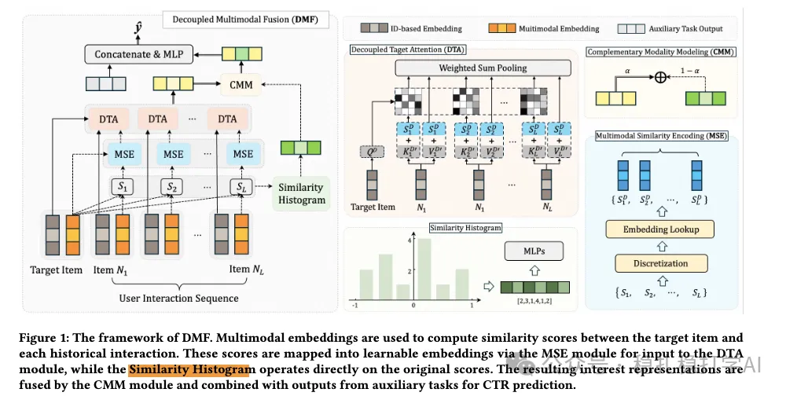

# 推荐算法(2025.10.28)：阿里的多模态行为序列建模，GMV +7.43%

> 原文：https://mp.weixin.qq.com/s/vGPHUP5Ni2ybouR4o5KMXQ
> 作者：算法工程师刘明星（稳扎稳打学AI）| 发表于 2025-10-28（修改于2025年10月28日）

嘿，记得给“稳扎稳打学AI”添加星标

关注我，每天为你精挑细选最优质、最新鲜的推荐算法paper，陪你一起保持进步、不断精进！

> [English version](2025-10-28-ali-dmf-lazada.full.en.md)

👆 [本公众号paper推荐原则](https://mp.weixin.qq.com/s/BhVGu0qH5kTz9N5zpsD3KA)

1 Decoupled Multimodal Fusion for Sequential Recommendation

网址：https://arxiv.org/pdf/2510.11066

公司：阿里（lazada）

思想：多模态+序列建模（相似度、直方图、互补模块）

方向：多模态行为序列建模

解读：本文主要用多模态信息做行为序列建模。核心是：在用target attention做行为序列建模的时候，将item的多模态也作为输入。两种做法，混合和独立。混合就是ID embed与多模态embed两者做“混合”建模。独立，就是多模态单独做序列建模。

（1）多模态信息

将历史序列中物品的多模态信息，与目标物品的多模态信息，计算相似度，得到一个list。具体的：

1）多模态特征：用一个预训练的模型，将物品的图片、文本等多模态信息，提取成一个向量。

2）相似度计算：将历史序列中每个物品的多模态向量，与目标物品的多模态向量，计算余弦相似度，得到一个相似度list。

（2）多模态序列建模

1）相似度直方图

相似的取值区间是，将其认为分成N个bucket，然后将步骤（1）的1）获得的相似度（list）分到不同的bucket里，从而形成了N长度的、元素是相似度数量的向量。将其接入一个MLP，获得一个向量。

2）相似度embed

figure1画的不清晰，1）获得的相似度，那么MSE，将相似度做离散化，再通过embedding layer转成与ID embed等长的embedding。

（3）互补模态模块

1）建模

利用（2）计算的结果：相似度直方图和相似度embed，对多模态信息进行建模。具体做法是：将相似度直方图和相似度embed拼接在一起，输入到一个MLP中，得到一个多模态兴趣向量。

2）融合

将多模态兴趣向量与ID兴趣向量进行融合，得到最终的兴趣向量。具体做法是：用一个门控机制，控制多模态兴趣向量和ID兴趣向量的权重，然后加权求和。

AB：Lazada上，提升GMV 7.43%。

心得：（1）本文的思路非常简单直接：用多模态信息来增强行为序列建模。这种方法的好处是：多模态信息可以提供更丰富的物品信息，从而提升模型的表达能力。（2）本文的相似度直方图和相似度embed也非常值得借鉴。相似度直方图可以捕捉到相似度的分布信息，而相似度embed可以将相似度信息转换成embedding，从而更好地与ID信息进行融合。

愚见：空

可信度：生产

推荐等级：有实践价值

请帮忙点赞、转发，谢谢。

## 欢迎干货投稿 \ 论文宣传 \ 合作交流

推荐您继续阅读：

■ [推荐算法(2025.10.25)：美团堆更多特征、堆更多上下文，2%效果](https://mp.weixin.qq.com/s/c5Fx867rNsZxgsNBhRu-kg)

■ [推荐算法(2025.10.23)：阿里的行为序列压缩强化主模型方法](https://mp.weixin.qq.com/s/QU8SzAl7NDVZAH_1Ybo7zA)

历史文章索引：https://docs.qq.com/sheet/DYXZTZ0tseHRyZGtt?tab=BB08J2

请入微信群，群内我会给出更深入的解读，还可以共同讨论技术方案、发招聘广告、内推和交友等。

• 铁粉标准：关注公众号一个月以上，且在公众号上累计15次互动（评论、爱心、转发）、或投稿1次，只欢迎技术同学。

• 入群方法：请您加个人微信lmxhappy，我拉您入群，请备注（只我个人看，不公开）。

喜欢的话点个在看吧👇

个人观点，仅供参考

修改于2025年10月28日
