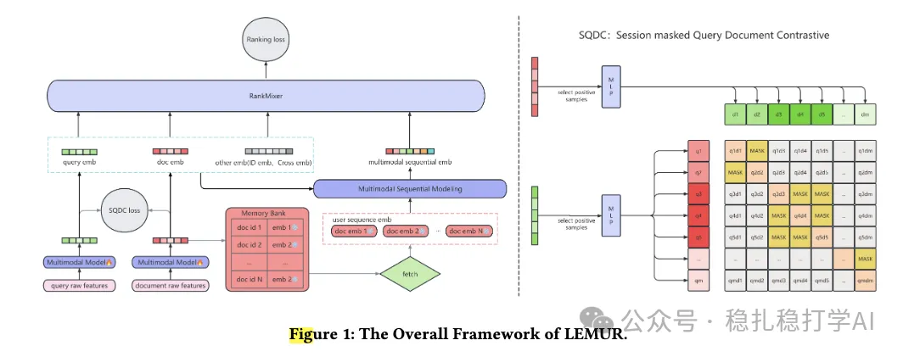

# Recommendation Paper Pick (2025.11.18): ByteDance trains multimodal and the main model jointly

> [中文版](2025-11-18-bytedance-lemur.md)

### Paper 1: LEMUR: Large scale End-to-end MUltimodal Recommendation
### Link: https://arxiv.org/pdf/2511.10962
### Company: ByteDance
### Idea: a compromise (static embeddings don't work, real-time computation isn't practical, so use semi-real-time cached data)
### Area: multimodal + behavior sequences

## Overview:

The paper presents a multimodal recommendation model with a multimodal encoder, MMEncoder for short, and a behavior sequence modeling module, Main Model for short. The two are trained together. It works well, but the compute cost is also high.

Multimodal encoder: MMEncoder

Pretrained models encode images and videos to get image embeddings and video embeddings, and a trainable Q-Former extracts an embedding for each item.

Behavior sequence modeling: Main Model

The embeddings in this paper receive both the collaborative signal from the main model and a contrastive learning signal across different items in the batch.

Jointly training multimodal and the main model has two big problems:

1) Encoding the full item corpus with the MMEncoder in real time is expensive.

The paper first encodes the full item corpus once to get embeddings. After that, embeddings for new items are computed incrementally on a schedule. They are cached in a parameter server, and model training uses the cached data directly instead of encoding in real time. Note that the cache is updated periodically, so it is semi-real-time.

2) Multimodal embeddings are high-dimensional and slow to update.

The paper maps the high-dimensional embeddings into a low-dimensional space to speed things up. Concretely, a two-layer MLP maps the high-dimensional embedding to a low-dimensional space while making sure the mapped low-dimensional embedding keeps the information of the original. In other words, high-dimensional embeddings are usually large (e.g. several thousand dimensions) and low-dimensional ones relatively small (e.g. a few hundred dimensions); the non-linear transform of the two-layer MLP reduces compute while keeping the information.

A/B: in a 14-day test on Douyin search, the query change rate was 0.843%, significantly better than the baseline model.

## Takeaways:

(1) Jointly training multimodal and the main model does improve results. On Douyin search, this paper's query change rate reached 0.843%, significantly better than the baseline model.

(2) Semi-real-time cached data is a compromise. Static embeddings don't work and real-time computation isn't practical, so semi-real-time cached data is used. This approach is worth borrowing.

(3) Multimodal embeddings are high-dimensional and slow to update; mapping them to a low-dimensional space with a two-layer MLP is also worth borrowing.

## Caveats:

Not publishing other metrics isn't great. If it's for confidentiality, the paper could just say so, that they can't be disclosed. Otherwise more peers will tend to assume it doesn't work.

## Credibility: production

## Recommendation: worth a look

