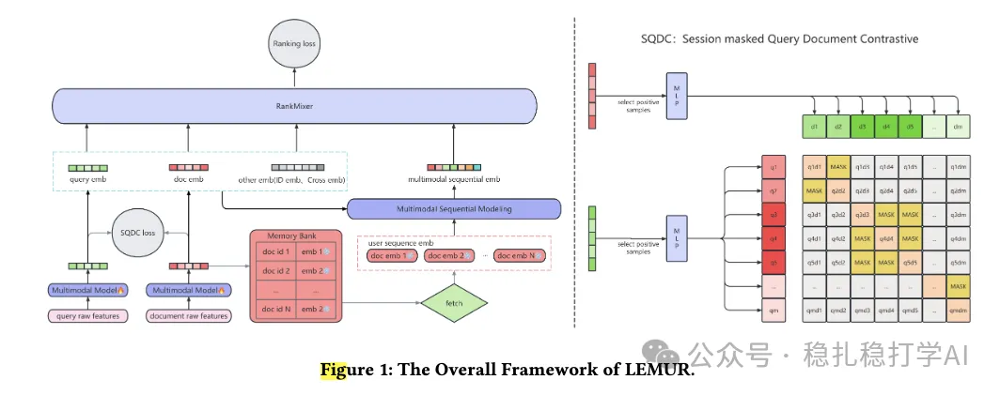

# 推荐算法(2025.11.18)：字节，多模态与主模型联合训练

> 原文：https://mp.weixin.qq.com/s/jZLF9RZzGX7mwJohCfbvEQ
> 作者：算法工程师刘明星（稳扎稳打学AI）| 发表于 2025-11-18

嘿，记得给“稳扎稳打学AI”添加星标

关注我，每天为你精挑细选最优质、最新鲜的推荐算法paper，陪你一起保持进步、不断精进！

👆 [本公众号paper推荐原则](https://mp.weixin.qq.com/s/BhVGu0qH5kTz9N5zpsD3KA)

1 LEMUR: Large scale End-to-end MUltimodal Recommendation

网址：https://arxiv.org/pdf/2511.10962

公司：字节

思想：折中（静态embed不work，实时计算不现实，就用半实时的缓存数据）

方向：多模态+行为序列

解读：

本文介绍了一个多模态推荐模型，包含一个多模态编码器，简称MMEncoder，一个行为序列建模模块，简称Main Model。两个模型一起训练。效果好，但是计算耗时也高。

多模态编码器：MMEncoder

就是用预训练的模型对图片和视频进行编码，拿到图片的embed和视频的embed。并用一个可训练的Q-Former提取出每个item的embed。

行为序列建模：Main Model

本文的embed，既接收来自主模型的协同信号，又接收batch内不同item的对比学习信号。

多模态与主模型联合训练，存在两大问题：

1）MMEncoder对全量物料实时编码的开销大。

本文先对全量物料都进行一次编码，得到embed。之后，定期增量计算新增物料的embed。然后用一个参数服务器缓存起来，模型训练时直接用缓存数据，而不是实时编码。注意，缓存数据是定期更新的，所以是半实时的。

2）多模态的embed维度高，更新慢。

本文将高维embed映射到低维空间来加速。具体做法是，用一个双层的MLP将高维embed映射到低维空间，并保证映射后的低维embed能够保留原始高维embed的信息。换句话说，高维embed的维度通常很大（例如几千维），低维embed的维度相对较小（例如几百维），通过双层MLP的非线性变换，可以在保留信息的同时减少计算量。

AB：在抖音搜索14天测试中，query change rate为0.843%，显著优于基线模型。

心得：

（1）将多模态与主模型联合训练的做法，确实能够提升效果。本文在抖音搜索上，query change rate达到了0.843%，显著优于基线模型。

（2）半实时的缓存数据，是一个折中的做法。静态embed不work，实时计算不现实，就用半实时的缓存数据。这个做法值得借鉴。

（3）多模态的embed维度高，更新慢，用双层MLP映射到低维空间的做法，也值得借鉴。

愚见：

不公布其它指标，不太好，如果是因为保密，可以直接说保密，不方便公开。因为更多的同行会倾向认为不work。

可信度：生产

推荐等级：推荐看看

请帮忙点赞、转发，谢谢。

## 欢迎干货投稿 \ 论文宣传 \ 合作交流

推荐您继续阅读：

■ [推荐算法(2025.11.17)：腾讯的one ad名叫GPR，GMV+2.11%](https://mp.weixin.qq.com/s/lWGbZU-XbodX2WgVVdOQkQ)

■ [推荐算法(2025.11.16)：Meta，群组信息增强网络效果，作为label指导](https://mp.weixin.qq.com/s/YYk4HBDoW_sJ86HlAGJEFQ)

历史文章索引：https://docs.qq.com/sheet/DYXZTZ0tseHRyZGtt?tab=BB08J2

请入微信群，群内我会给出更深入的解读，还可以共同讨论技术方案、发招聘广告、内推和交友等。

• 铁粉标准：关注公众号一个月以上，且在公众号上累计15次互动（评论、爱心、转发）、或投稿1次，只欢迎技术同学。

• 入群方法：请您加个人微信lmxhappy，我拉您入群，请备注（只我个人看，不公开）。

喜欢的话点个在看吧👇

个人观点，仅供参考
