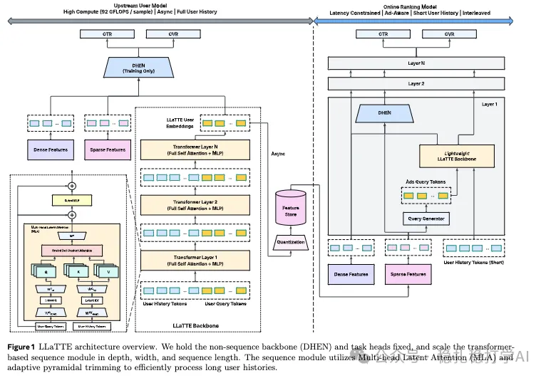

# Recommendation algorithms (2026.1.29): Meta, offline long-sequence modeling, conversion rate +4.3%

> [中文版](2026-01-29-meta-llatte.md)

1 LLaTTE: Scaling Sequential Recommendation with Large Language Model and Time-aware Embedding

Link: https://arxiv.org/pdf/2601.19413

Company: Meta

Area: long-sequence modeling

Overview:

This Meta work is offline long-sequence modeling: it moves sequence modeling offline. Specifically:

(1) Take a user's entire behavior sequence as input

That is, all of the user's behavior across Meta's multiple products is concatenated into one long sequence.

(2) Sequence modeling

The sequence modeling part is the key. The approach:

1) Sequence tokenization: each behavior is abstracted into a token, which includes the action type, item id, timestamp, time interval, and so on.

2) Positional encoding: relative time positional encoding is introduced, i.e. the time gap between each behavior and the current moment.

3) Modeling with a Transformer: it uses MLA, the MHA implementation proposed by DeepSeek-V2, followed by a gated MLP.

(3) Getting the user interest representations

Only the final query tokens are kept, flattened and concatenated, and fed into a LoRA MLP to get a fixed number of representations. These representations, together with other dense and sparse features, go through a DHEN model, which finally outputs two predictions: CTR and CVR. At the same time, the representations are quantized and cached in a store. Note that the user's representation in the store is recomputed and updated at the moment the user converts.

A/B: conversion rate +4.3%.

Takeaways:
(1) The most important reason this method works is high transfer efficiency combined with bringing in semantic features. One reason earlier work didn't get results this good is that they didn't scale up sequence length, model depth and model width at the same time.
(2) Meta says in the paper that it borrowed OneTrans's pyramid reduction, which deserves credit.

It shows that without semantic features on sequence items, however big the model, it only memorizes patterns; with them, the scaling slope doubles outright. This had not been clearly verified before.

Credibility: production

Recommendation: practically useful
