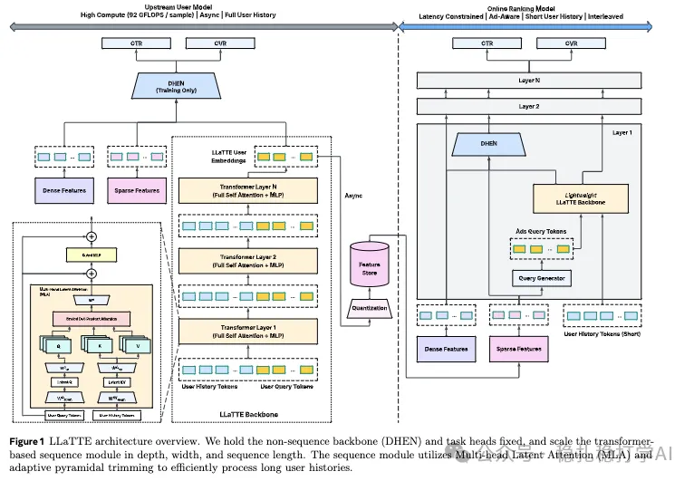

# 推荐算法(2026.1.29)：Meta，离线长序列建模，转化率+4.3%

> 原文：https://mp.weixin.qq.com/s/cV_f_kaFIhi-fwazrhRW7w
> 作者：算法工程师刘明星（稳扎稳打学AI）| 发表于 2026-01-29

嘿，记得给“稳扎稳打学AI”添加星标

关注我，每天为你精挑细选最优质、最新鲜的推荐算法paper，陪你一起保持进步、不断精进！

> [English version](2026-01-29-meta-llatte.full.en.md)

👆 [本公众号paper推荐原则](https://mp.weixin.qq.com/s/BhVGu0qH5kTz9N5zpsD3KA)

1 LLaTTE: Scaling Sequential Recommendation with Large Language Model and Time-aware Embedding

网址：https://arxiv.org/pdf/2601.19413

公司：Meta

方向：长序列建模

解读：

Meta这篇工作是离线长序列建模，将序列建模搬到了离线。具体做法是：

（1）把一个用户的全部行为序列作为输入

即把用户在Meta的多个产品上的所有行为，全部拼接起来，作为一个长序列。

（2）序列建模

序列建模部分是关键，做法是：

1）序列token化：把每个行为抽象为一个token，token包括：行为类型、item id、时间戳、时间间隔等。

2）位置编码：引入相对时间位置编码，即每个行为与当前时刻的时间间隔。

3）使用Transformer建模：使用了DeepSeek-V2提出来的MHA模型实现——MLA，后接gated MLP。

（3）获得用户兴趣表征

只保留最终查询令牌，flat拼接，输入一个Lora MLP，获得固定数量的多个表征。这些表征与其它dense特征、sparse特征，经过DHEN模型，最终输出两个预估——CTR和CVR。与此同时，表征经过量化，缓存到存储store里。注意用户在store的该表征重新计算并更新的时机，是用户发生了转化的时刻。

AB：转化率+4.3%。

心得：
（1）本方法能成功的最重要的原因是高转移效率结合语义特征的引入。前人没有拿到这么好效果的一个原因，是没有同时加大序列长度、模型深度和模型宽度。
（2）Meta在paper里说借鉴了OneTrans的金字塔缩减，这个做法值得表扬。

证明了序列item没有语义特征，模型再大也只是记忆模式，有了之后缩放斜率直接翻倍，这是之前没明确验证的。

可信度：生产

推荐等级：有实践价值

请帮忙点赞、转发，谢谢。

## 欢迎干货投稿 \ 论文宣传 \ 合作交流

推荐您继续阅读：

[推荐算法(2026.1.26)：阿里，后推荐召回居然用上了排序模型，转化+1%](https://mp.weixin.qq.com/s/aXnARzxBImS6HzhbJMnhGw)

[全新生成式范式重塑搜推：物品ID序列上也能做推理！](https://mp.weixin.qq.com/s/BEBKjAyYPg3Muf1Xpc2xhw)

历史文章索引：https://docs.qq.com/sheet/DYXZTZ0tseHRyZGtt?tab=BB08J2

请入微信群，群内我会给出更深入的解读，还可以共同讨论技术方案、发招聘广告、内推和交友等。

铁粉标准：关注公众号一个月以上，且在公众号上累计15次互动（评论、爱心、转发）、或投稿1次，只欢迎技术同学。

入群方法：请您加个人微信lmxhappy，我拉您入群，请备注（只我个人看，不公开）。

喜欢的话点个在看吧👇

个人观点，仅供参考
