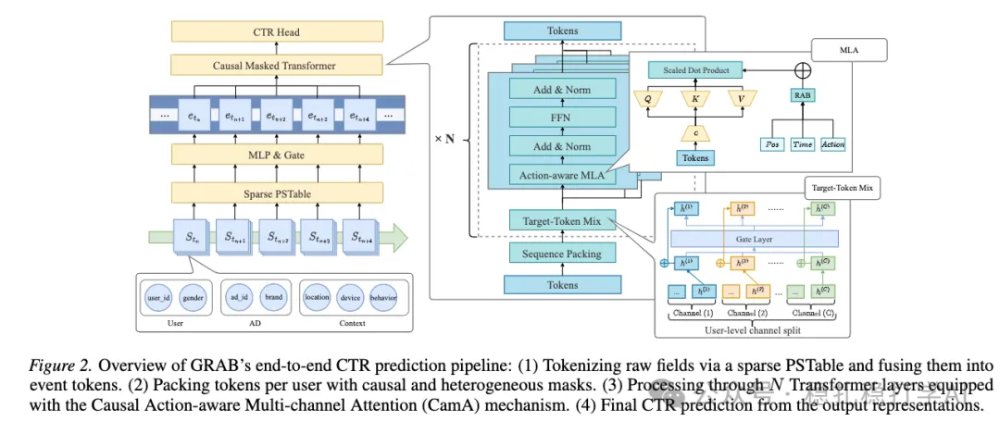

# Recommendation algorithms (2026.2.6): Baidu, long-sequence CTR modeling, average ad revenue +3%

> [中文版](2026-02-06-baidu-grab.md)

1 GRAB: A Generative Framework for Long Sequence Modeling in Ads Ranking

Link: https://arxiv.org/pdf/2601.20217

Company: Baidu

Area: long-sequence modeling

Overview:

This Baidu work is long-sequence CTR modeling, a very practical method.

The method has two main parts:

(1) Long-sequence packing

The contiguous segments formed by the behavior sequences of all users in a batch are concatenated. This gives one contiguous long sequence that needs no padding for alignment.

(2) Self-attention

There are two kinds of token:

One is called the partial token, which contains: timestamp, item category, action type, and time granularity (second/minute/hour/day/week).

The other is called the full token, which, besides what the partial token contains, also has user id, gender, and so on. In self-attention, a partial token only attends to partial tokens and itself; a full token also only attends to partial tokens and itself.

This looks like a block-diagonal lower-triangular matrix, which prevents interference across users.

In particular, it introduces a multi-channel parallel computation method: similar to MoE, the user behavior sequence is split into channel-specific sub-sequences, causal self-attention is computed independently with multiple sets of networks (weights), and the results are summed with weights.

In addition, it uses a two-stage alternating training method:

- Sequence stage: freeze the underlying sparse network and optimize the sequence encoder first.
- Sparse stage: freeze the sequence encoder and train the sparse network.

The two stages alternate.

A/B: on full traffic, average ad revenue +3%.

Takeaways:
(1) The point of long-sequence modeling is not simply making the sequence longer, but finding new structures and training methods that balance efficiency, accuracy and cost-effectiveness. GRAB is a good example.
(2) The method in this paper can also be used for recommendation and search modeling.
(3) In self-attention, does information from different users' behavior sequences interfere with each other? This is a very important point. The method proposed here is novel.
(4) The method in this paper can be extended to other areas, such as long-sequence modeling and time-series modeling.

Caveats: readability has room for improvement.

Credibility: production

Recommendation: worth a look

