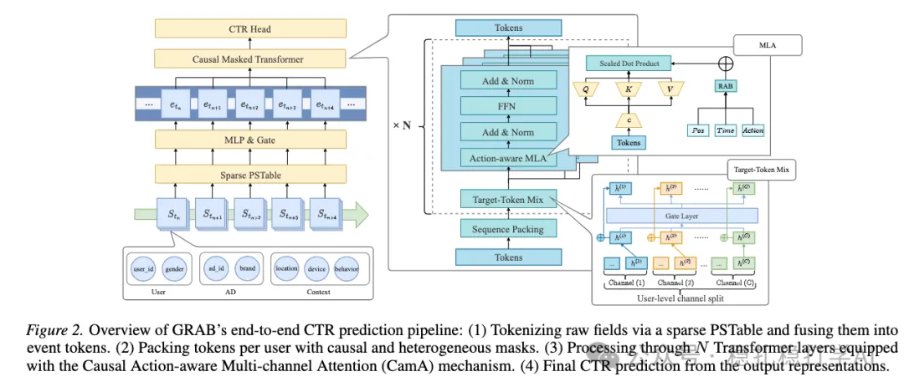

# 推荐算法(2026.2.6)：百度，长序列CTR建模，广告平均收入+3%

> 原文：https://mp.weixin.qq.com/s/iVOIfoNyrxYrj5dZpMKu0g
> 作者：算法工程师刘明星（稳扎稳打学AI）| 发表于 2026-02-06

嘿，记得给“稳扎稳打学AI”添加星标

关注我，每天为你精挑细选最优质、最新鲜的推荐算法paper，陪你一起保持进步、不断精进！

> [English version](2026-02-06-baidu-grab.full.en.md)

👆 [本公众号paper推荐原则](https://mp.weixin.qq.com/s/BhVGu0qH5kTz9N5zpsD3KA)

1 GRAB: A Generative Framework for Long Sequence Modeling in Ads Ranking

网址：https://arxiv.org/pdf/2601.20217

公司：百度

方向：长序列建模

解读：

百度这篇工作是长序列CTR建模，非常实用的方法。

方法主要包括两部分：

（1）长序列拼接

将一个batch里的所有用的行为序列形成的这样的连续段，拼接。这样，就是连续的、不需要做填充对其的一个长序列。

（2）自注意力

一个token，包括：

一个叫partial token，包括：时间戳、物品类别、动作类型、时间粒度（秒/分钟/小时/天/周）。

另一个叫full token，除了partial token包括的东西外，还有user id、gender等。self-attention计算的时候，partial token只attend partial token和自身；full token也是只partial token和自身。

这像一个块对角的下三角矩阵，防止跨用户干扰。

特别，引入了一个多通道并行的计算法方法：就跟MOE类似，将用户行为序列拆分成通道特定的子序列，用多套的网络（weights）独立计算因果自注意力，再加权求和。

另外，还用了两阶段的交替的训练方法：

- 序列阶段：冻结底层的稀疏网络，先优化序列编码器。
- 稀疏阶段：冻结序列编码器，训练稀疏网络。

这两个阶段交替进行。

AB：全量流量，平均广告收入提升 3%。

心得：
（1）长序列建模的重点，不是直接把序列放长，而是在高效、准确、性价比的平衡上，摸索出新的结构和训练方法。GRAB就是一个好的示范。
（2）这篇文章的方法也可以用来做推荐、搜索的建模。
（3）自注意力计算的时候，用户行为序列之间的信息是否会互相干扰？这是一个很重要的点。这篇提出的方法很新颖。
（4）这篇文章的方法可以扩展到其他领域，比如长序列建模、时间序列建模等。

愚见：可读性有提升空间。

可信度：生产

推荐等级：推荐看看

请帮忙点赞、转发，谢谢。

## 欢迎干货投稿 \ 论文宣传 \ 合作交流

推荐您继续阅读：

[推荐算法(2026.2.2)：字节，多模态引入推荐模型的新方法](https://mp.weixin.qq.com/s/E3GtWE-SMIwHkw6GoyuZ0w)

[推荐算法(2026.1.30)：字节，创新的语义ID生成方法](https://mp.weixin.qq.com/s/Ts8VSDhJPCRPzdK4skr1qQ)

历史文章索引：https://docs.qq.com/sheet/DYXZTZ0tseHRyZGtt?tab=BB08J2

请入微信群，群内我会给出更深入的解读，还可以共同讨论技术方案、发招聘广告、内推和交友等。

铁粉标准：关注公众号一个月以上，且在公众号上累计15次互动（评论、爱心、转发）、或投稿1次，只欢迎技术同学。

入群方法：请您加个人微信lmxhappy，我拉您入群，请备注（只我个人看，不公开）。

喜欢的话点个在看吧👇

个人观点，仅供参考
