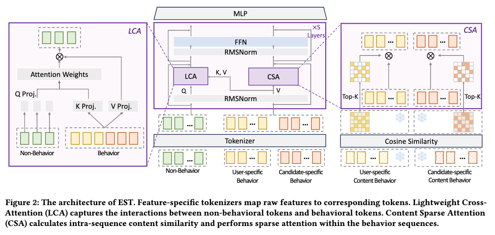

# Alibaba Taobao: unified modeling of heterogeneous features, an industrial CTR approach with RPM +3%

> [中文版](alibaba-est.md)

### Paper: EST: Towards Efficient Scaling Laws in Click-Through Rate Prediction via Unified Modeling
### Link: https://arxiv.org/pdf/2602.10811v1
### Company: Alibaba
### Idea: attention sparsification
### Area: behavior sequence modeling + feature crossing

## Overview:
This paper proposes a feature-crossing model that replaces self-attention.

The model unifies all heterogeneous features into one token sequence, stacks multiple feature-crossing layers to refine high-quality representations of the sequence features and the non-sequence features separately, and finally feeds the refined representations into an MLP on top for accurate click-through rate (CTR) prediction.

This paper can be seen as OneTrans 2.0. The core difference is that behavior-behavior interaction changes from dense causal self-attention to content-based sparse attention. In both, the end result is that the non-behavior features can see the behavior sequence. Pyramid vs sparse attention: it is not obvious which one actually costs less compute.

There are two reasons for replacing self-attention:
* **Unnecessary**: global attention turns out to be unnecessary; self-interaction between behaviors is redundant. Note that the context here is modeling heterogeneous sequences; that doesn't mean the claim holds for modeling homogeneous sequences. According to Meta's HSTU 2.0 paper, sequence self-attention is important. The two do not contradict each other.
* **Harmful**: information flowing from behavior sequence features to non-sequence features is helpful, but the reverse is harmful. Non-sequence features such as the user profile and candidate attributes are high-density information and the core of the decision; they should actively pull information from low-density features (such as sequence features). If low-density features (such as sequence features) are also made to aggregate information from high-density features (such as non-sequence features), it amounts to "diluting" strong signals across many redundant behavior tokens, and the high-value signals (non-sequence features) get polluted.

Each crossing layer works as follows:
### (1) Non-sequence features
A module called LCA (lightweight cross-attention) is added. Through LCA, non-sequence features actively aggregate high-value information from the sequence features.

#### 1) Feature processing:
* Non-sequence features: each feature goes through an embedding layer, then through a different MLP to get its feature embedding.
* Sequence features: ids go through an embedding layer, then through one MLP shared by all sequence elements to get the feature embedding.

#### 2) Network:
Each non-sequence feature's embedding goes through RMSNorm and its own linear transform to become the Query; the sequence features go through RMSNorm to become Key and Value; cross-attention is computed, followed by one linear transform, with a different matrix for each non-sequence feature. Then RMSNorm, a **per-token FFN**, and a residual sum.

In LCA, the sequence features play a supporting role; the lead is modeling the non-sequence features, which get enhanced with sequence information.

### (2) Sequence features
Since information is moved from the sequence features to the non-sequence features, the sequence features also need updating. So another module is added, CSA (content-based sparse self-attention), which handles refinement within the sequence.

#### Network:
Self-attention is computed. Key and Query come from the item's multimodal representation (normalized text and image embeddings, frozen weights), while Value is the sequence embedding used in (1).
To reduce complexity, it uses row-wise top-K sparsification: only the top-K attention scores are kept and the rest are set to 0. This yields new representations of the sequence items.

After that comes RMSNorm, a **shared FFN**, and a residual sum.

Multimodal similarity directly captures semantic similarity of images/text (a visual/text prior), whereas the similarity learned from ID-based tokens is mainly "co-occurrence statistics". The two are complementary and the information density is higher. So this counts as an optimization point.

### (3) Subsequent processing
LCA and CSA form the EST module. Stacking multiple EST layers yields sequence and non-sequence features of the same shape.
The sequence representation is mean-pooled into a refined behavior representation, concatenated with the non-sequence representations into one vector, and fed directly to the MLP prediction head, whose last layer outputs a 1-dimensional logit to model CTR. The loss is binary cross-entropy.

### A/B:
Taobao display ads, Guess You Like: CTR +1%, RPM +3%; product detail page shopping: CTR +2%, RPM +2.7%

## Takeaways:
* Recently I've noticed many papers using the information density of features/interactions as the core design basis for network architecture. It's no longer adding attention on a hunch; instead they first quantify which interactions/features are "information-rich" and which are "redundant/low-density", then prune, sparsify or restructure the architecture accordingly. This has moved from "empirical inductive bias" to "quantifiable, verifiable engineering insight", very much in line with the thinking behind LLM scaling laws.
* Over the last year or two, many papers are really doing one thing: making the attention scope more precise when doing attention, and getting better results from that.

## Caveats
The sentence "behavior-to-behavior interactions are largely redundant" in Section 4 of the paper holds under the premise of heterogeneous unified modeling, but it is stated too absolutely and lacks explicit qualifying conditions, which can easily lead readers to think behavior-behavior self-interaction has no value in any recommendation scenario.

## Credibility: production

## Recommendation: practically useful

