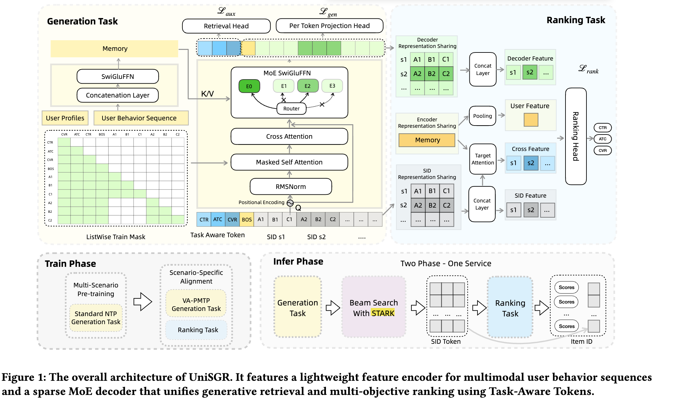

# Alibaba adds a user SID feature, GMV +6%

> [中文版](alibaba-unisgr.md)

### Paper: UniSGR: Unified Framework for Semantic ID Generation and Ranking
### Link: https://arxiv.org/pdf/2607.04068
### Company: Alibaba
### Idea: generative user modeling
### Area: behavior sequence modeling

## Overview:
This paper is behavior sequence modeling, with the core goal of getting high-quality user representations. It uses an Encoder-Decoder model: the encoder turns the user behavior sequence into hidden states, and the decoder uses those states to generate user SIDs. In the end it produces 4 representations, which are plugged into the main network to improve modeling.

### (1) Generation network
The behavior sequence predicts target items. Within a session, n clicked, n add-to-cart and n purchased items are collected as targets. Each user's sequence is used to predict and generate 3*n targets. Both the sequence items and the targets are represented as SIDs. The network is an encoder-decoder architecture, consisting of:
* Encoder: encodes the user features and the behavior sequence into hidden states. The user profile goes through an MLP to get one token. Each item in the behavior sequence goes through RQ-VAE to get SID tokens. The two are concatenated into one full sequence, which goes through the encoder to get the final states. The encoder here is MemoryNet (linear complexity O(L), not self-attention), and its output is denoted Memory M.
* Decoder: based on the states output by the encoder, it predicts and generates the SIDs of the target items. The decoder's input is not only the special BOS token and the tokens generated in the previous step (the initial input is empty); task tokens (introduced below) are also prepended. The input first goes through self-attention, then cross-attention with the states, then a sparse MoE, and finally outputs the corresponding embedding sequence, which is the internal hidden state (→ Decoder Representation). There are two downstream heads:
    * head1: one head processes the embedding sequence corresponding to the task tokens, extracting the Task Token representations for contrastive learning.
    * head2: the other head predicts each token (generating the semantic IDs). Note that the SIDs of multiple target items are predicted in parallel here.

The target embeddings output by the decoder are used to compute the generation loss. In particular, as described above, the SIDs of multiple target items are predicted in parallel, which strengthens the diversity of generation. It also accounts for the strength of the behavior signal: click, add-to-cart and purchase are progressively stronger signals, and they get different weights in the generation loss, with stronger signals getting larger weights. Note that in attention, the target items are masked from attending to each other.

#### Auxiliary task: task tokens
As mentioned above, besides the SID tokens of the generated target items, the decoder input also adds 3 special tokens: the task tokens. That is, dedicated tokens are set up for the click, add-to-cart and purchase tasks, concatenated with the special start token BOS, followed by the SID tokens of the generated target items.

The decoder output embedding for each task token represents the predicted target embedding for that task. Each task token embedding is paired with the target of the corresponding behavior (positive), and a contrastive learning auxiliary task improves that embedding. That is, for the 3 task embeddings, each uses a different negative sampling strategy to sample some negatives, and an auxiliary loss is computed against a target (all sample targets are positive), improving the generation quality of the generative model.

### (2) Joint generation-ranking training
**Pre-training**
In the first stage, data from all scenarios is mixed together as samples to train the generative model. Later it is trained jointly with the corresponding ranking model in each specific scenario.

In a specific scenario, the generation network and the ranking network are trained jointly. Here the generation network acts as the upstream network and feeds 4 inputs into the ranking network. Specifically:
* The decoder's internal hidden states, of fixed count, concatenated into one representation.
* The encoder's output hidden states, with two operations: first, pooling to get one representation; second, target attention with the target item to get an interest representation. So this gives two representations.
* The multiple target SIDs generated by the decoder, of fixed count, concatenated into one representation.

### A/B:
Lazada homepage Guess You Like: IPV +3.36%, number of orders +2.17%, GMV +5.68%

## Comparison with a similar paper
It is very similar to a recent paper, [tokenminds](./tokenminds.md): both are Encoder-Decoder architectures that use the behavior sequence to generate user SID tokens and then inject them into the ranking model.

Core similarities: both use an Encoder-Decoder to model the user behavior sequence generatively as a User SID, then feed the intermediate representations to the ranking model. Three points are exactly the same:
1. Items are discretized into SIDs with RQ-VAE as the basic unit of the sequence
2. The encoder encodes the behavior sequence → hidden states, and the decoder autoregressively generates the target SIDs
3. Multiple targets are predicted in parallel (rather than a single next item), using the generation task to drive user representation learning

Core differences (3)
1. How the generation target is defined: TokenMinds randomly samples targets from a future 24h window, "predicting the interest distribution over a period of time"; UniSGR samples within a session by behavior type (click/add-to-cart/purchase), "predicting targets for multiple business signals"
→ one learns a distribution, the other learns multi-task signals
2. How business signals are injected: TokenMinds relies on sample weighting (engagement reward), so the signal is in the loss weights; UniSGR relies on Task Tokens + contrastive learning, so the signal is in the decoder input, plus a separate auxiliary contrastive loss
→ one is external weighting, the other is structured conditioning + contrast
3. How generation and ranking are combined: TokenMinds is decoupled. The generative model is trained independently, and its representations are transformed offline before being fed to ranking (even as an asynchronous background service); UniSGR is joint. The generation network is upstream and is trained jointly with the ranking network, L = L_gen + α·L_rank
→ one is a pipeline, the other is end-to-end

## Takeaways:
* The Google and Alibaba work is basically the same, showing that getting user SIDs through a generative model can help improve the network model. Both works are thoroughly industrial in style.

## Caveats
* Although the paper calls them Task-Aware Tokens, functionally they are essentially Task Tokens: three learnable tokens representing different business objectives (click / atc / pay), placed at the very front of the decoder input. The word "Aware" is a bit redundant. It doesn't really let the tokens "sense" anything themselves; rather, through position + causal mask + the subsequent contrastive learning (FACL), the whole decoder computation is conditioned on the task signal from the first step.
* Memory M is a sequence (length ≈ 1 + L), not a single vector. The name is poorly chosen; I thought it was a cache. It would be easier to understand if it were removed from Figure 1.
* In Figure 1, the decoder has more than 2 inputs, but there are 2 masks; the two are inconsistent.

## Credibility: production

## Recommendation: practically useful
