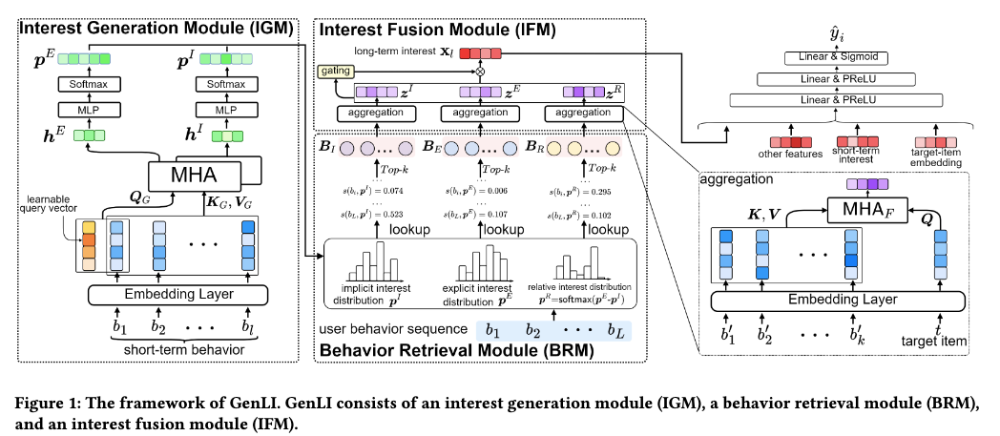

# Meituan, long-term interest modeling, RPM +1.6%

> [中文版](meituan-genli.md)

### Paper: Generative Long-term User Interest Modeling for Click-Through Rate Prediction
### Link: https://arxiv.org/pdf/2605.15905
### Company: Meituan
### Idea: intent
### Area: long behavior sequence modeling

## Overview:
This paper is a new method for interest modeling on long behavior sequences. It uses the short-term behavior sequence to get the user's intents (immediate intent and short-term intent), retrieves relevant behaviors from the long-term behavior sequence, does target attention, fuses the results into an interest representation, and adds it to the main network to improve the model.

### (1) Interest generation module
Take the user's recent short-term behavior sequence and do multi-head target attention. Key and value are naturally the sequence; the query has two elements, one is the target item and the other is `$` (corresponding to a learnable embedding; the paper doesn't use `$`, it just says a learnable embedding). This yields two interest representations.

The interest representation for the target item is the immediate interest; like CLS in BERT, the interest representation for `$` is the global interest over recent behavior, which can be seen as the short-term intent. The difference between the two is taken as another interest representation. So there are 3 interest representations. An interest representation, put another way, is an intent vector (distribution), so there are 3 distributions.

### (2) Behavior retrieval module
From the long-term behavior sequence, relevant behaviors are retrieved for each of the three intent distributions. For example, for the immediate intent distribution, all historical behaviors are hashed by ID into 4096 buckets, and behaviors in the buckets whose dimension values are top-k are picked first.

This maps each dimension of the intent distribution to a hash bucket (determined by ID % 4096). All items that fall into that bucket inherit the probability value of that dimension as their "intent relevance score". It is a compromise that uses simple hashing to achieve soft grouping + intent weighting, giving up a bit of semantic precision in exchange for maximum computation speed.

### (3) Interest fusion module
Multi-head target attention is applied to each of the three behavior sets. The Query is the current target item, and Key / Value = the embedding sequence of behaviors retrieved by the BRM, giving three interest representations. The three are concatenated and fed into a gate network to get weights for each, and the three representations are fused by weighting into one interest representation.

### A/B:
Meituan ads: CTR +0.776%, RPM (revenue per thousand impressions) +1.567%.

## Takeaways:
* This paper works because it uses short-term behavior as the user's intent. The intent for the target and the intent for the difference between the two are not very important.

## Caveats
* Intent modeling is already a highly mature and popular direction in recommendation and ads, with a large amount of related work in recent years. This paper is essentially "efficient long-sequence intent modeling done by way of a generated distribution". Although the paper calls it "Generative", the name is not very accurate. It is not a generative model in the strict sense and has little to do with the current mainstream "predict the next token" style of generative recommendation. A more accurate description would be: intent modeling based on a generated distribution.
* In the behavior retrieval module, items falling into one bucket may be completely unrelated, yet they are given exactly the same intent strength even if they have nothing to do with each other semantically. Items of different categories are forcibly "tied together", which in theory pollutes the purity of the intent distribution. If a user has a strong intent for milk tea, phones and hotels in the same bucket would wrongly get high scores too. By comparison, Meta's recent work [mos](./meta-mos.full.en.md), which maps items to specific topics through a codebook, is more reasonable.
* In a ranking setting, directly calling the result of short-term behavior + target attention "immediate intent" is not quite appropriate. It is more accurately a "conditional interest representation for the current candidate", rather than the user's pure immediate intent.

## Credibility: production

## Recommendation: practically useful

