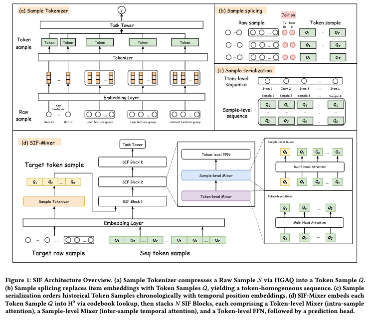

# Meituan, tokenizing sequence samples, CTR +2%

> [中文版](meituan-sample-is-feature.md)

### Paper: Sample Is Feature: Beyond Item-Level, Toward Sample-Level Tokens for Unified Large Recommender Models
### Link: https://arxiv.org/pdf/2604.15650
### Company: Meituan
### Idea: getting more features into the model, residual quantization
### Area: sequence modeling

## Overview:
During sequence modeling, the sequence items are tokenized, using as many features as possible to improve modeling. That is, the sequence items are tokenized first, then sequence modeling is done. Tokenization is the module that converts raw, high-dimensional, heterogeneous features (especially multi-field features) into discrete tokens (integer indices) that the model can use directly.

SIF consists of two key components:
### 1. Tokenizing sequence items
Each historical interaction item is a complete feature tuple (user profile, item, context, cross features). All of these features are used, but it can't be one very long concatenated representation, so the information has to be compressed, which means tokenization.

Method: first split the features into G groups by semantics, then split each group by granularity B into subgroups. Each subgroup is a sub-token and is projected to a fixed dimension d₀ with its own linear projection. Each sub-token goes through M-level residual quantization (RVQ) to get discrete codebook indices. This way, one sequence item is compressed into T (T = G × B × M) tokens, corresponding to very few bits (e.g. 648 bits), while keeping almost all of the original sample information.

Unlike RQ-VAE, RVQ does multi-level residual quantization without a full Encoder-Decoder reconstruction structure, approximating the original vector with a sum of multiple codebook vectors, with higher precision.

In this construction there are two losses:
* The standard VQ commitment loss.
* An extra auxiliary loss: the representations of all sub-tokens of each item are fused together (e.g. concatenated), followed by an MLP, then sigmoid, and BCE is computed. The BCE of all items is summed as this loss. It makes the codebook organize around "prediction relevance" rather than pure reconstruction error.

This way, the position in the history sequence that used to hold the "item ID" now holds a full Token Sample (several sub-tokens concatenated), achieving sample-level tokens and fully leaving behind item-level information loss.

### 2. Sequence modeling
A factorized design based on the MLP-Mixer idea models the sequence (made up of history items and the target), stacked from N SIF Blocks. After that, the T sub-tokens of the target item are mean-pooled, followed by a two-layer MLP to get the CTR/CVR scores.

Each Block does a three-step factorization (the key is separating attention directions):
* Row attention: self-attention among the T sub-tokens within each sequence item, capturing inter-group correlations such as user-item-context. This way, each sub-token fuses information from the other sub-tokens.
* Column attention: at the same sub-token position, self-attention across all history sequence items (including the target item), modeling temporal dynamics so the current request can fully "see" the historical samples. This way, each sub-token fuses information from the same-position sub-tokens of the other history items. In particular, each sub-token of the target item fuses the same-position sub-tokens of the history sequence.
* Token-level FFN: a position-wise nonlinear transform.

Two losses:
* A target-sequence alignment loss: the target item's features are split and organized the same way as the sequence items to get each sub-token, which is mapped by a linear projection into the same dimensional space as the history codebook. An alignment loss aligns them to the same codebook space, ensuring the target is fully isomorphic with the sequence and in the same space.
* Main loss: BCE.

### A/B:
Fully launched on Meituan's food delivery platform, CTR about +2.03%.

## Takeaways:
* Several Meituan papers focus on using as many of an item's features as possible to improve the model. This is a kind of "fattening" (enriching the sequence item representation), and it has more or less led a direction.
* More features are very likely good for sequence modeling, but due to earlier technical limitations, large numbers of features couldn't be used as the representation of sequence items. However, now that residual quantization has matured in recent years, it can be used to fold large numbers of features, even the full feature set, into the representation.
* RVQ is usually used to compress the continuous semantic vectors output by large multimodal models (e.g. video or text encoders). This paper instead applies RVQ to ordinary structured feature-group embeddings. The goal is not to compress semantics, but to unify hundreds of heterogeneous feature fields into tokens of the same format so they can be plugged into a Transformer. This is an unconventional use of RVQ.

## Caveats
* Be bold in coining terms, or put the colloquial phrasing straight into the paper; Meta is very daring in this respect. Tokenizing sequence items in this paper is really just "fattening".

## Credibility: production

## Recommendation: practically useful

