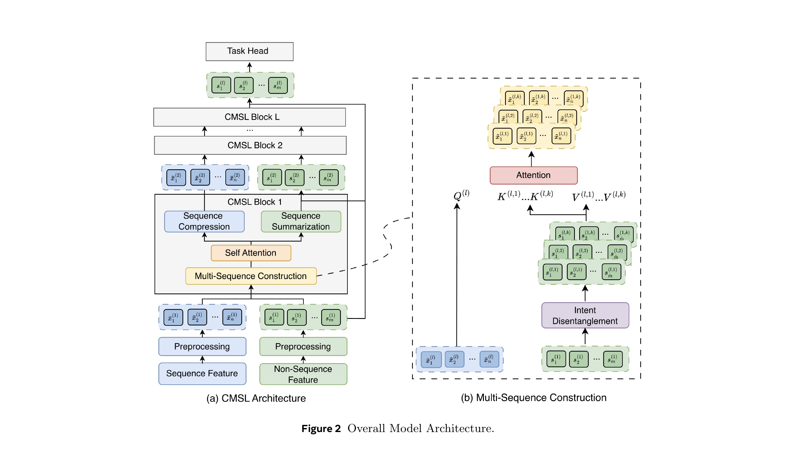

# Meta turns the user behavior sequence into clean intent streams

> [中文版](meta-cmsl.md)

### Paper: CMSL: Constructive Multi-Sequence Learning for Recommendation Systems
### Link: https://arxiv.org/pdf/2606.28533
### Company: Meta
### Idea: intent, denoising
### Area: behavior sequence modeling, intent modeling

## Overview:
This paper changes the user history from "one sequence that is read passively" into "K clean intent sequences that are actively constructed". It is a new sequence modeling method that mitigates context pollution.

Sequence and non-sequence features interact in both directions: first the non-sequence intents split the sequence into K clean sequences (construction), each doing its own self-attention; then the non-sequence intents pick out K vectors $h$ from the sequences (summarization), and $h$ is fed back to the non-sequence side of the next layer. After stacking L layers, the K $h$ vectors of the last layer are concatenated and fed to the task heads.

### (1) Processing sequence features
The behavior histories users generate across modalities (clicks, likes, comments, etc.) are huge in volume and varied in format. Concatenating them directly would bring unaffordable compute cost, so they are first grouped and then compressed into one sequence of controllable length, $\bar X$.

User $u$'s interaction history is defined as a set of sequences:
$$\mathcal{X} = \{X^{(1)}, X^{(2)}, \dots, X^{(B)}\}$$
Each $X^{(b)} = \{x_1^{(b)}, \dots, x_n^{(b)}\}$ represents one interaction modality (clicks, likes, comments, etc.), and $x_i^{(b)}$ is an item/action ID, turned into an embedding sequence through a shared embedding layer.

**1. Grouping**

$\mathcal{X}_g$ is a subset picked/grouped out of the original $\mathcal{X}$ (B interaction-modality sequences) by some shared attribute, i.e. the same surface/page: $\mathcal{X}_g = {X^{(1)}, \dots, X^{(M)}}$, M ≤ B. That is, sequences are first grouped by surface, and the M modality sequences within a group are then compressed together (weighted sum).

So one $X$ yields multiple $\mathcal{X}_g$

**2. Multi-sequence merging**

There are a great many user sequences on the platform, and processing them directly is very expensive, so they need to be compressed. For each element of $\mathcal{X}_g$ (one modality sequence), pad to length n and compute token weights with a dedicated MLP: $$s_i^{(m)} = \sigma(\text{MLP}^{(m)}(x_i^{(m)}))$$ ($\sigma$ is sigmoid).

The token weights are multiplied onto the corresponding elements of the token sequence. For multiple $\mathcal{X}_g$, each $\mathcal{X}_g$ is a token sequence of length n, and summing gives the compressed sequence: $$\bar{X} = \sum_{m=1}^M (s^{(m)} \cdot X^{(m)}) \in \mathbb{R}^{n \times d}$$

### (2) Processing non-sequence features
Besides the usual dense/sparse preprocessing, the non-sequence features are additionally decomposed into K groups of representations with different "intent" leanings, each turned into a set of Keys/Values for the cross-attention on the sequence side later.

**1. Preprocessing**
* Dense Features (continuous features such as user age, item price, video watch time): concatenated into a raw vector, normalized (Norm), followed by one linear transform.
* Sparse Features (sparse, high-cardinality features such as country code, user language, item category): each feature has its own embedding table. Multi-valued features (such as interest tag lists) use sum-pooling (summing embeddings). This also ends up as a d-dimensional embedding, aligned with the dense feature dimension.

**2. Intent disentanglement**
1. m non-sequence features → a token sequence of length m → through "Intent Disentanglement" (K corresponding transforms), giving K sequences (each of length m), i.e. $s^{(l,1)}, \dots, s^{(l,K)}$ in the figure.
2. These K sequences each go through linear transforms to produce their own keys and values, ending up with K Key sequences and K Value sequences.

### (3) Sequence attends to non-sequence
 Cross-attention is computed (Q from the sequence, K/V from the non-sequence side). The current compressed behavior sequence $\bar{X}$ is projected into Query $\mathbf{Q}^l$, and multi-head attention is applied to each non-behavior group $(\mathbf{K}^{l,k}, \mathbf{V}^{l,k})$, producing sequence $\tilde{X}^{(l,k)}$.
 
 This operation gives each behavior a tailored summary of the non-sequence context. It lets the non-sequence side help denoise and split the sequence.

The K "intent filters" generated from the non-sequence features filter the same behavior sequence into K sequence views, each "dominated by one intent, with the others faded". The goal is to separate the different intents at the representation level before self-attention, so that later, when each sequence does temporal modeling internally, there is no cross-intent interference (pollution).

 This corresponds to Multi-sequence construction in the figure below.

 ### (4) Self-attention within the sequence
 
 On the sequence $\tilde{X}^{(l,k)}$ from the previous section, linear attention is applied, approximating the HSTU attention widely used at Meta, producing sequence $\tilde{X}^{(l,k)}$ (same name).

This corresponds to Self-attention in the figure below.

### (5) Non-sequence attends to sequence features
Cross-attention between sequence and non-sequence features. The non-sequence sequences $s^{(l,1)}, \dots, s^{(l,K)}$ serve as Q, and the behavior sequences $\tilde{X}^{(l,k)}$ serve as Key and Value. Cross-attention gives K such sequences.

$\mathbf{h}^{(l,k)} = \text{Cross-Attention}(Q = \mathbf{S}^{(l,k)}, K = \tilde{X}^{(l,k)}, V = \tilde{X}^{(l,k)})$

The physical meaning of $h^{(l,k)}$ is: "from the viewpoint of the $k$-th intent (non-sequence), go into this behavior sequence, pick out the behaviors most relevant to this intent, and aggregate them into a fixed-length summary vector."
Also, it is essentially a target-attention (DIN-style) pooling, except the "target" is replaced by an "intent vector".

This corresponds to Sequence Summarization in the figure below.

### (6) Sequence compression 

There are K token sequences of length n; at each position, the K tokens are concatenated and fed into their corresponding MLP to get a vector of length d
: $$\bar{X}^{(l)} = \text{MLP}([\tilde{X}^{(l-1,1)} \parallel \cdots \parallel \tilde{X}^{(l-1,K)}])$$

This gives a token sequence of length n, with each token of length d.

### (7) Final fusion

Note that (3)–(6) above are packaged into one CMSL Block, stacked L layers. Final fusion takes only the K summary vectors $h^{(L,k)}$ of the **last layer**, concatenates them into $H = [h^{(L,1)} \parallel \cdots \parallel h^{(L,K)}]$, and feeds that into multiple task-specific heads (CTR, CVR and other predictions).

That is, what actually goes into the tower is the summary vector $h$ produced by "non-sequence queries sequence" in (5). It belongs to the non-sequence side and carries information distilled from the behavior sequence; **the behavior sequence itself does not go into the tower directly** (it is only passed down between layers through the sequence compression in (6)).

Why is the final output of the sequence features discarded? Because from (3) on, what you get are intent representations expressed through the non-sequence features, no longer behavior representations. By (5), the intent representations in the sequence have already been well fused into the non-sequence features.

### A/B:
Deployed on five Meta surfaces: ranking NE down 0.06%~0.62%, four retrieval engagement metrics up 0.09%~0.17%, all statistically significant.

## Supplement: overall comparison of OneTrans / EST / CMSL

All three works address "how sequence features and non-sequence features should interact", but take completely different routes. The lineage is roughly: **OneTrans** (ByteDance) was first to propose "one Transformer doing both sequence modeling and feature crossing"; **EST** (Alibaba, [ali-est.md](alibaba-est.full.en.md)) calls itself OneTrans 2.0, explicitly modularizes the directionality implied by OneTrans's causal mask, and brings in multimodal priors for sparsification; **CMSL** (Meta) focuses on a problem neither of the first two raised: **"context pollution" caused by cramming several unrelated intents into one sequence**. Its solution is to first "split" one behavior sequence into K sequences, each with a clean intent, then model them separately.

| Dimension | OneTrans | EST | CMSL |
|---|---|---|---|
| Core problem | Sequence modeling and feature crossing are optimized as two separate lines, with no unified backbone | Under heterogeneous unified modeling, behavior-behavior self-attention is redundant, and the wrong direction dilutes high-value signals | One sequence crammed with several unrelated intents that interfere with each other and dilute the true intent (Context Pollution) |
| Overall paradigm | S/NS concatenated into one sequence; one shared causal self-attn handles all interactions | Split into two dedicated modules (LCA + CSA), explicit division of labor but still stacked layer by layer | Each layer first constructs K clean intent sequences from 1 sequence, each does self-attn, then compresses back to 1 |
| Behavior-behavior (S-S) interaction | Dense causal self-attention, full history visible, one set of weights shared on the S side | Content-based **sparse** attention (CSA): Q/K use frozen multimodal image/text embeddings, top-K sparsification | Each clean sequence does its own **linear attention** (approximating HSTU, polynomial kernel + sparse correction) |
| Handling multiple heterogeneous sequences | Interleaved by timestamp or concatenated with [SEP] into one, length unchanged | No special multi-sequence compression; focuses on sparsifying a single behavior sequence | First grouped by surface and gate-compressed into one, then each layer "constructs" K parallel sequences |
| How the sequence ← non-sequence direction is used | Determined by causal mask order: NS placed after, naturally sees all of S (S cannot see NS) | LCA: **NS as Q, S as K/V**, used to enhance non-sequence representations | Multi-sequence construction: **S as Q, NS as K/V**, used to "construct" K intent sequences (an intermediate step, not the final fusion) |
| How the non-sequence ← sequence direction is used | Same as above (NS attends S is the whole mechanism) | Same as LCA; the two are one module | Sequence Summarization (PMA): **NS as Q, S as K/V**, producing summary vectors $h^{(l,k)}$, which are what actually feed the next layer/tower |
| Complexity reduction | Pyramid query truncation (full K/V, Q narrowed layer by layer) + cross-request KV Cache | Row-wise top-K sparsification of attention scores | Gated compression + linear attention + inter-layer MLP compression to keep the number of K sequences from exploding |
| Extra priors | None (pure ID/side-info embeddings) | Multimodal (image/text) semantic similarity for attention routing | No extra modality prior; the focus is the structural design of "intent routing" |
| What finally goes into the tower | NS-token states (S information already absorbed by NS) | Pooled sequence representation + LCA-enhanced non-sequence representations, concatenated | The K PMA summary vectors $h^{(L,k)}$ of the last layer, concatenated (produced by "NS queries S"; the sequence itself does not go into the tower directly) |

What distinguishes CMSL: **before** self-attention, it adds a construction step where "the sequence as Q queries the non-sequence side", using K non-sequence intent branches to reinterpret one sequence as K parallel clean sequences. Neither OneTrans nor EST has this mechanism, and it is the only design among the three that explicitly tackles "multiple intents interfering with each other". In other words, **EST does subtraction "inside one sequence" (sparsification + direction control), while CMSL reworks the more upstream question of "should there be only one sequence at all" (split first, then model)**. The two are innovations at different levels of abstraction.

## Takeaways:
* In each layer, this paper lets the sequence and non-sequence sides exchange information in both directions (sequence queries non-sequence in the construction stage, non-sequence queries sequence in the summarization stage), and finally models multiple tasks with the summary vectors $h$ distilled on the non-sequence side.
* Before fusion in CMSL, the sequence has already gone through four rounds of processing: grouping, gated compression, linear attention and global compression. $\bar{X}$ is already a compact representation that has been repeatedly filtered and weighted, so it may no longer fit the "low-density, redundant" assumption, and the "dilution" risk EST worries about may not hold.

## Caveats
* In the paper, the notation for the result of the CMSL Attention is not updated; it is the same as the earlier compressed result $\bar{X}^{(l,k)}$.
* The writing has room for improvement; it could be better organized and more readable.
* The batch of "K sequences" in Equation 6 (and the $\bar X^{(l,k)}$ used as K/V in Equation 5) should, per the notation in Figure 2, be tilde, not bar.

## Credibility: production

## Recommendation: practically useful

