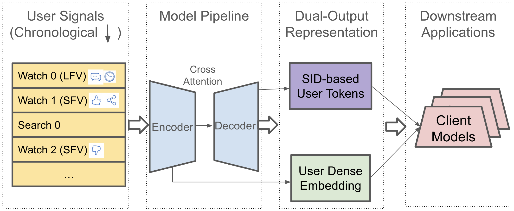

# YouTube Shorts model adds user SID features, and shows they help

> [中文版](tokenminds.md)

### Paper: TokenMinds: Pretrained User Tokens and Embeddings for User Understanding in Large Recommender Systems
### Link: https://arxiv.org/abs/2606.25147
### Company: Google DeepMind / YouTube
### Idea: generative user modeling
### Area: user behavior sequence modeling

## Overview:
This paper is about behavior sequence modeling, with the core goal of getting high-quality user representations. An Encoder-Decoder model outputs both discrete user tokens (SID sequences) and a dense user embedding; the two representations are injected into the downstream ranking model separately or jointly, giving semantic, generalizable modeling of user interests. The encoder produces hidden states from the user behavior sequence, and the decoder uses these states to generate user SIDs. At the same time, the states are aggregated into one embedding, which is the dense user embedding.

### Encoder (370M MoE)
Processes the full user history sequence and outputs the dense user embedding. The hidden state sequence the encoder produces is pooled (last-token / mean pooling, etc.) into a 1152-dimensional embedding, which serves as the dense user embedding.

**Input sequence construction:**
The user's watch sequence in chronological order (most recent 1200). Each watch = <Condition> + prefix-L SID (L=4, a coarse prefix) + soft tokens (watch time ratio, device and other features). <Condition> is the surface information, either LFV (long-form video) or SFV (short-form video). The sequence also includes the user's text search behavior.

An RQ-VAE is trained to get item SIDs; when training that RQ-VAE, the length is $L_{full}$. But when feeding the Encoder-Decoder and generating discrete SID user tokens, only the first $L$ levels are used. The loss is also computed only on the prefix-L SID.

**Unified cross-surface modeling**: there are both LFV (long-form) and SFV (short-form) videos. Their consumption patterns differ a lot (SFV is continuous browsing with stronger feedback), but user interests overlap (about 40% overlap on the first two SID prefix levels). A surface condition token (<LFV> / <SFV>) is put before each watch. They share one SID vocabulary.

Why train long SIDs but use short ones?
With the full SID, the model easily memorizes specific videos, so generated results have poor diversity and weak generalization. Using a shorter prefix lets the model generate at a coarser semantic level, which makes it easier to produce diverse interest tokens.

### Decoder (370M Dense)
Autoregressively generates discrete SID user tokens (beam search produces several candidate sequences). For each user sample, it does not predict the next watch; instead, up to N=15 targets are randomly sampled from the future 24h window. For one user sample (one training example), the encoder runs only 1 forward pass; the decoder has to generate SIDs for N targets, but it does not simply run N times: it shares the same encoder hidden states and processes the N targets at once through cross-attention.

Why do this? So the model learns the interest distribution over a near-future period, instead of only fixating on the next instantaneous action. This clearly improves generalization, especially for cold start.

Two more small tricks:
* Sample weighting: each user sample gets an engagement reward $r(W_i)$, encouraging high-quality, diverse consumption.
* Importance sampling: training targets are importance-sampled by reward size, so high-value samples appear more often in training.

### Supplement: 3 ways to turn user SIDs into embeddings:
The decoder generates B=40 SID sequences, which need to be turned into embeddings that can be injected into the ranking model:
1. **Prefix Embedding Mapping** (static): map the predicted prefix-L SID back to original content embeddings and take the mean embedding of all videos under that prefix. Intuitive, but no learning capacity.
2. **N-gram Embedding** (learnable): cut the SID sequence into fixed-length n-grams, look up each n-gram in a learnable embedding table, and sum to get the user vector. Each n-gram maps to a learnable embedding (an embedding table trained from scratch); these n-gram embeddings are added (or concatenated) to get the final user vector.
3. **SentencePiece Embedding** (learnable): do variable-length subword tokenization (BPE-style) on the SID sequence and look up learnable embeddings. SentencePiece (BPE-like subword segmentation) splits the SID sequence into variable-length subwords. SentencePiece learns from a large number of SID sequences which codeword combinations should be treated as one "subword". Each learned subword has a learnable embedding. Finally these subword embeddings are combined into the user vector.

### A/B:
On short-form video, engaged users +0.11%, satisfied engagement +0.62%.

## Takeaways:
* Item SIDs are semantic IDs obtained by "discretizing" with a content quantization model (RQ-VAE), while user SIDs are interest tokens "generated" autoregressively by a generative model. Both are called SIDs, but they are products of two different paradigms: one is discretization of content representations, the other is generative modeling of the user's future behavior.
* Generative user modeling: using the semantic IDs (SIDs) of items the user will consume in the future as the training target drives the encoder to learn predictive user representations.
* **The dual-output design is the core highlight**: the dense embedding captures a continuous interest space and the discrete tokens capture semantic categories, so the two are naturally complementary. The former suits similarity computation on the retrieval side, the latter suits feature crossing on the ranking side, and injecting both works best.
* **SID truncation is a counterintuitive key trick**: using a coarse prefix instead of the full SID as the generation target trades precision for generalization. Cold start improves the most; removing it causes a drop of up to 17.1%.

## Caveats
* The 24h look-ahead window may add noise in time-sensitive scenarios (breaking news, live sports); dynamically adjusting the window size is worth exploring.
* As a generative model, training and inference are inconsistent: at inference time, the target's related non-SID information is no longer available. This information may not matter much, so the impact is probably manageable.
* This paper generates user SIDs from the behavior sequence only. But users have many other features (demographics, region, device, real-time context, etc.) that also carry interest signals. In principle, all user features (including the behavior sequence) could be fed into the encoder together to generate a more complete user SID. Then the user SID would no longer be just "a compression of the behavior sequence" but "a generative expression of the user's whole profile".

## Credibility: production

## Recommendation: practically useful
