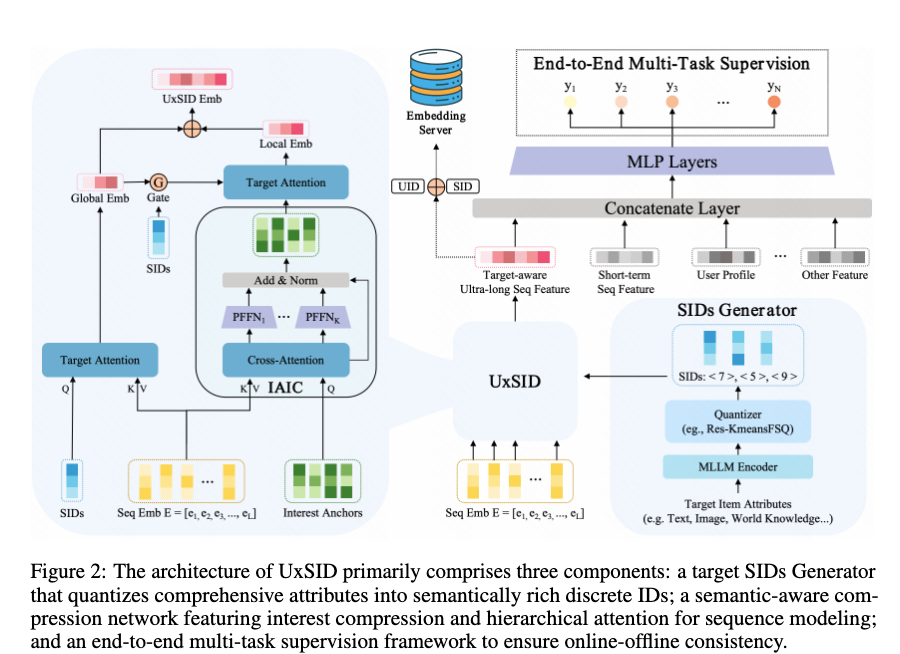

# Kuaishou handles ultra-long sequence modeling with clustering, revenue +0.3%

> [中文版](kuaishou-uxsid.md)

### Paper: UxSID: Semantic-Aware User Interests Modeling for Ultra-Long Sequence
### Link: https://arxiv.org/pdf/2605.09040
### Company: Kuaishou
### Idea: clustering
### Area: ultra-long sequence modeling

## Overview:
The paper proposes a new method for ultra-long sequence modeling: represent the target with multimodal features, compress the ultra-long sequence into K interest anchors, then do two parallel target attentions (computed offline, served online) to get two interest representations, which are fed into the main network to improve the model.

Note that all the computation is offline; online it only does table lookups plus light operations, which gives very low latency and constant compute.

In detail:
### (1) Representing the target item
The target item's multimodal attributes (video frames, text descriptions, etc.) go through a multimodal large model to get a semantic vector. Then Res-KmeansFSQ hybrid quantization (hierarchical residual quantization, similar to RQ-VAE) produces hierarchical SIDs.
The first-level code $k_1$ is called the target SID. In the later interest modeling, the embedding obtained by passing it through the embedding layer represents the target item. The reason: the coarse category a target belongs to is, to a degree, enough, and this keeps things efficient.

### (2) Interest compression
Interest modeling on the user's behavior sequence is done **offline**, producing K interest representations. Just as BERT introduces the special [cls] token to get a global representation of the whole text, the ultra-long raw sequence is compressed into a small, fixed number of learnable special tokens.
Specifically, representations of all sequence items from the embedding layer serve as Key and Value. Meanwhile K tokens are defined, each with a representation from the embedding layer, K << L, typically K=16, serving as Query. Cross-attention gives K representations, each further processed independently with a per-token FFN (PFFN) + residual + LayerNorm.
An orthogonality constraint is also used to ensure different anchors capture different aspects of user interest and keep diversity. The result is K compressed interest representations. To tell them apart, they are called the K interest anchors.

The reason for not making the whole long sequence multimodal is that the cost would explode and the gain may not be high. Each prediction only concerns the current single candidate, so running one MLLM inference + quantization for it to generate the target SID is an acceptable industrial cost.

### (3) Interest retrieval
Two kinds of target attention are done, giving two user interest representations.

* Interest retrieval over the raw sequence: done offline. Because the target is represented by the first-level target SID, there are only codebook-size possibilities in total, so target attention over the user sequence can be computed offline for all SIDs. Going further, because the items a user interacts with are limited and interests are concentrated, a user only interacts with a small number of SIDs, say 100, so only these active SIDs need to be used, further cutting compute. After computation, results are cached with (userid, sid) as the key for online lookup. Online, the representation eg is looked up.

* Interest retrieval over the interest anchors: also done offline. Again for the user's top-k active SIDs, each SID's representation first goes through a two-layer MLP + Sigmoid to produce a gating vector. Its Hadamard product with the target SID embedding is used as the query to do target attention over the K interest anchors. After computation, results are also cached with (userid, sid) as the key for online lookup. Online, the representation el is looked up.

An intuitive way to understand the process: first let the target "take a look" at the user's whole history (giving eg), then based on "how the target feels after seeing the history" decide how to refine itself (producing the query), and finally use the refined self to precisely match against the compressed anchors (giving el).

Finally the two representations eg and el from the two stages are fused (usually concat or weighted) into the final UxSID interest representation, which is fed into the main network to improve the model.

### A/B:
Revenue +0.337%.

## Takeaways:
* The technique of turning a long sequence into K interest anchors already exists in MIMN, HPMN, PinnerFormer and other works; UxSID did not invent it. Its core contribution is combining this mature compression technique with the target SID and interest retrieval.
* The target is clustered and the sequence is clustered; once you cluster, you can precompute offline, which solves the ultra-long sequence problem.
* Discretizing the target (SID) shrinks the computation space from infinite to finite, so everything can be precomputed offline.

## Caveats
* Calling the interest representation from modeling the raw sequence the "global interest representation" and the one from modeling the interest anchors the "local interest representation" is not appropriate. Because that interest representation is obtained from the global sequence; it is a more abstract representation, and it is also global.

## Credibility: production

## Recommendation: practically useful

