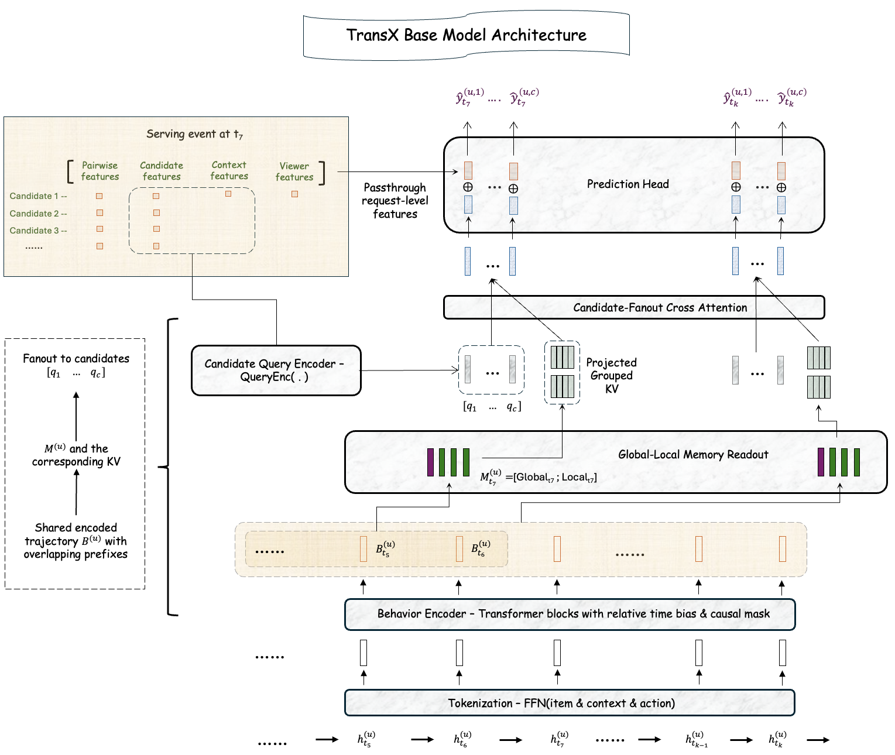

# LinkedIn: compress the user sequence offline, do only candidate interaction online, CTR +6%

> [中文版](linkedin-transx.md)

### Paper: TransX Technical Report: Scaling Sequence Transduction for Recommendation
### Link: https://arxiv.org/abs/2610.20913
### Company: LinkedIn
### Idea: decouple user-side compute from candidate-side compute; precompute + nearline refresh
### Area: ultra-long behavior sequence modeling

## Overview

Long-sequence models re-encode the user's history online on every request. The longer the history and the bigger the model, the more expensive serving gets, until it becomes impractical. This paper splits the model in two: the part that does not depend on the candidate is computed before the request arrives and stored as KV; at request time, the model fetches that KV and runs candidate cross-attention against it. The model can grow without online cost growing with it.

Sequence modeling becomes a three-stage pipeline: **encode the user history**, **compress the encoding into a fixed-size "memory"**, **let each candidate read that memory**.

**Behavior sequence (thousands of events) → ① causal Transformer → thousands of vectors, same length → ② compression → 64 vectors (projected to KV) → ③ candidate cross-attention → score**

① and ② depend only on the user and are computed ahead of time offline. Only ③ runs when a request comes in.

## ① The behavior sequence goes through a causal Transformer

Each past event (the item interacted with, action type, surface, timestamp, etc.) goes through an MLP to become one token, then through 4 causal Transformer layers (d=1024, 32 heads), with a learned bias on attention scores based on time difference. The causal mask means each position sees only events before it, so when new events are appended, earlier positions' outputs do not change and can be reused. History window is 180 days, up to 8,192 tokens in offline training.

Training exploits the same property. A user is requested many times at different points in time, and each request sees a different prefix of the same sequence. TransX packs a user's whole sequence into one training unit and **runs the causal encoder once**; each request takes the memory at its own cutoff, and all candidates in that request share that memory to compute the loss.

## ② Compress ①'s output: most recent 32 + older 32

①'s output is as long as the raw history, possibly thousands of positions; letting every candidate attend over all of it is too expensive. So the **last 32 positions** are kept as is, and older history is split into blocks (every 64 / 32 / 16 positions for heavy / medium / light users), each block pooled into one vector by a learned attention pooler, up to 32 of them. Together that is at most 64 vectors: the user's memory.

Compressing to 64 vectors does not mean only recent behavior is seen. The encoder runs causal attention over the full history, so the outputs at the last 32 positions already carry earlier behavior. How far back a candidate can draw information is set by how much history the encoder takes in; how many vectors a candidate reads is set only by memory size (64). Decoupling the two lets history keep growing (encoding runs offline anyway) while online reads stay fixed.

The pooling inside a block is simple: a shared small network gives each position a scalar score, scores are softmax-normalized within the block, and positions are summed with those weights. It has a useful property: pooled results of two adjacent segments can be merged directly, like blockwise softmax (keep the max, the denominator and the weighted sum). In training, one sequence is cut at many request cutoffs, and each cutoff has different "older block summaries"; thanks to this property, all of them come out of a single prefix scan instead of being recomputed per request.

## ③ The candidate does target attention over ②'s result

Candidate features are encoded with **the same tokenizer and embedding tables** as history events, except the action field is set to a dedicated "unknown action" symbol (it has not happened yet). The candidate vector is the query; the 64 vectors from ② are projected to keys and values; 2 cross-attention layers are stacked (layer 2 uses the candidate vector updated by layer 1 as its query; keys and values stay the same).

Two kinds of sharing cut the cost:
- **Across candidates**: a request has about 1,000 candidates, each with its own query, but they all read the same keys and values, computed and stored once. Same idea as HSTU, except HSTU recomputes the user side online on every request and shares it only within that request; here the KV is precomputed, stored, and shared across requests.
- **Across attention heads**: in standard multi-head attention every head has its own keys and values. Here it is grouped-query attention (GQA): 32 heads each have their own query, but every 8 heads share one set of keys and values, 4 sets in total. The KV each user needs to store and transfer is 1/8 of standard multi-head attention.

③'s output (one vector per candidate) is concatenated with the usual user, candidate, context and user-candidate cross features, then goes through a DCNv2 + Deep&Wide head to predict click and conversion.

## A/B

Control is the production HSTU-style sequential model (home page, landing pages); treatment and control each get 20% of traffic for at least 7 days: CTR +6.02%, conversion +4.45%, DAU +0.26%. CTR lift for heavy / medium / light users is +6.2% / +6.0% / +5.5%, and the gain held over a five-week holdout.

## Takeaways

- "Precompute the user side offline" is not new; what is new is the extra compression layer. Store one vector and the candidate cannot pick out relevant behavior; store the full sequence KV (as in OneTrans) and storage grows with history length; this paper stores 64 compressed vectors and gets both.
- Very close to Kuaishou's UxSID. Both compress an ultra-long sequence into a small fixed set of vectors stored offline, which candidates then read. They differ in three ways: how they compress (UxSID by interest, with learnable queries over raw embeddings; TransX by time, recent kept and older pooled), where candidate interaction happens (UxSID offline, by discretizing the candidate into a Semantic ID and caching per user and SID; TransX online, with the candidate's full features), and whether the sequence is encoded before compression (UxSID no; TransX yes, with a causal Transformer).
