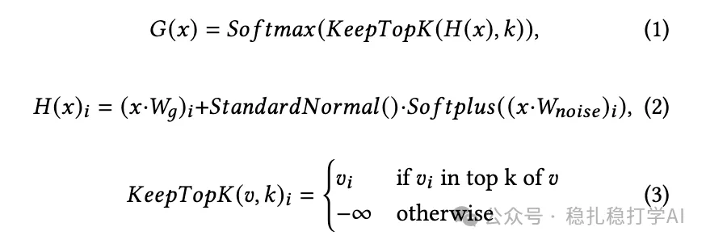
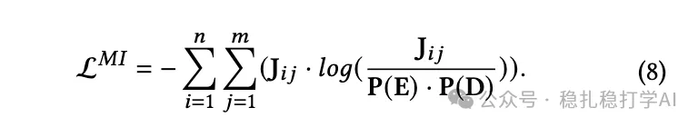
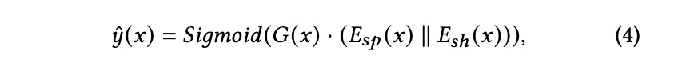
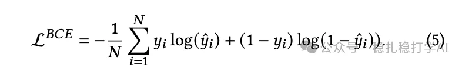
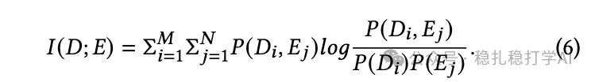
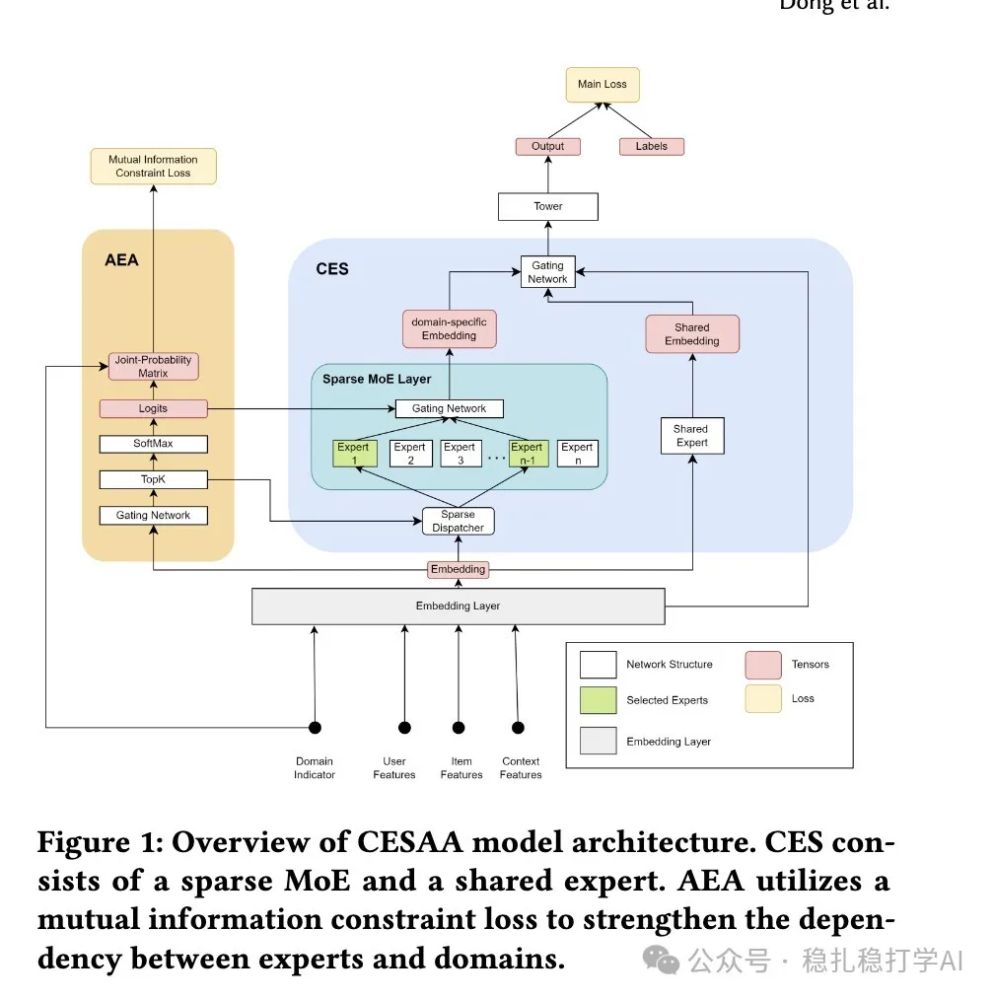

# Recommendation papers

> [中文版](2024-11-12-adaptive-conditional-expert-selection.md)

1.Adaptive Conditional Expert Selection Network for Multi-domain Recommendation

Link: https://arxiv.org/pdf/2411.06826

Company: OPPO

Area: cross-domain recommendation.

Summary: uses the mutual information between experts and domains to describe how related they are, and for each sample automatically selects a subset of experts from the expert pool to process its data (which means experts not selected don't participate in computing that sample, which to some extent addresses the scalability problem).

Credibility: production

Recommendation: worth a look.

There's only one paper today, so I'll take some time to go through it in detail.

(1) AEA: Adaptive expert allocation. First compute the relevance between each sample and each expert. How is relevance computed? See formulas (1)–(3) below. G(x) is the logits in the figure. G(x) is how relevant each expert is to the current sample's domain.

1) Formula (1) computes each expert's logits, formula (2) maps the input x onto each expert, and formula (3) sets every entry of G(x) outside the top-k experts to -∞. The purpose is that each sample's domain uses only some of the experts.

2) At actual inference time, only the top-k experts are used (k=2 in this paper).

3) Every expert receives the same input.

4) Loss: a loss between the domain label and the joint probability density of all experts and domains.

(2) CES: Conditional expert selection.

1) The shared expert is trained on samples from all domains.

2) Domain-specific expert: trained on samples of its own domain, and does inference on samples of its own domain. Note: domain-shared experts and domain-specific experts have the same architecture and inputs; they only differ in which samples they get during training.

3) Computed by formula (4): concatenate the domain-specific embedding with the shared embedding, and activate it (Hadamard product) with the same-dimension output of a gate network.

Note: the physical meaning of the Hadamard product is a kind of feature crossing.

Overall loss of the network: as below, the sum of the main network's BCE loss and the mutual information loss.

The mutual information between an expert and a domain is defined as follows: Di is the i-th domain, E is the j-th expert.

So the joint probability density of each domain and each expert needs to be computed.

How is it computed? The paper uses an online method, per formula (7). Jk-1 is the previous result and Jk is the current result. dk is the sample's one-hot domain label. gk is the logits output by the softmax in the left figure.

Postscript: readers, I didn't understand how P(E) and P(D) are computed. Can anyone enlighten me?

Figure 1: Overview of CESAA model architecture. CES consists of a sparse MoE and a shared expert. AEA utilizes a mutual information constraint loss to strengthen the dependency between experts and domains.
