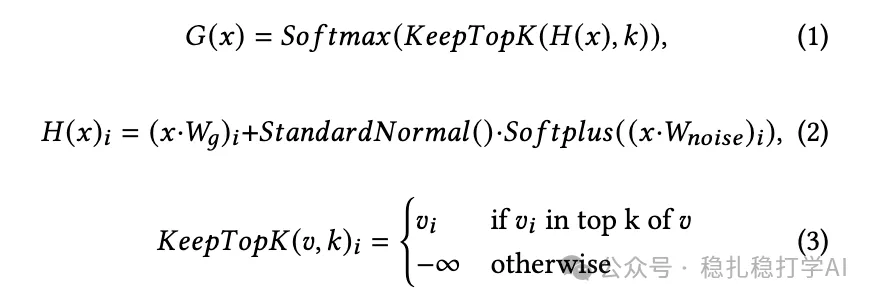
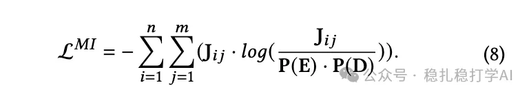
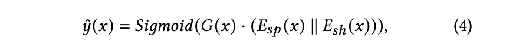
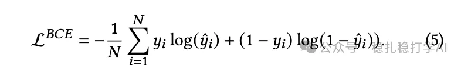
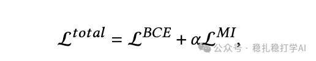
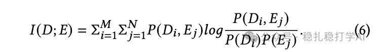
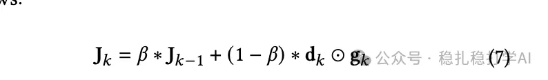
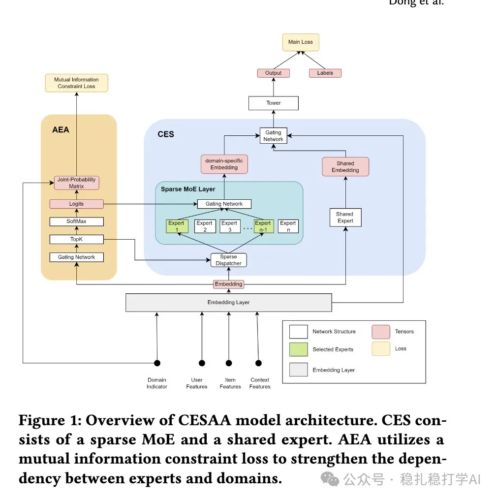

# 推荐算法paper

> 原文：https://mp.weixin.qq.com/s/Rh7ugs3hRTHMKtBVuZtslQ
> 作者：算法工程师刘明星（稳扎稳打学AI）| 发表于 2024-11-12

关注我，每天为你精挑细选最优质、最新鲜的推荐算法paper，陪你一起保持进步、不断精进！

* 推荐标准：大都是大厂的、少量学术的ranking model。
* 更新频率：日更。
* 来源：arxiv.org。
* 阅读建议：优先看前面的。

1.Adaptive Conditional Expert Selection Network for Multi-domain Recommendation

网址：https://arxiv.org/pdf/2411.06826

公司：OPPO

方向：跨域推荐。

概括：通过expert与domain之间的互信息描述两者的相关性，为每个样本自动从expert群里选择部分expert们运算其数据（意味着未被选中的expert不参与该样本的运算，这样可以一定程度上解决scalability的问题）。请移步[推荐算法paper](https://mp.weixin.qq.com/s/Rh7ugs3hRTHMKtBVuZtslQ)，查看更详细的解读。

可信度：生产

推荐等级：值得看看。

今天就一篇paper，所以花点时间细讲讲。

（1）AEA：即Adaptive expert allocation。首先计算出每个样本与每个expert的相关性。相关性如何计算？请看以下公式（1）-（3），G(x)，就是图上的logits。G(x)就是各expert与当前样本的domain的相关性程度。

1）公式（1）是每个expert的logits计算公式，公式（2）是把输入x映射到各expert上，公式（3）是把G(x)中，top-k个expert之外的，全部置为-∞。这样做的目的是为了实现每个样本对应的domain，只用部分expert。

2）在实际推理时，只使用top-k个expert（本paper的k=2）。

3）每个expert接收的输入是相同的。

4）loss：domain label和所有expert和domain的联合概率密度loss。

（2）CES：即Conditional expert selection。

1）shared expert接收所有domain的样本进行训练。

2）domain-specific expert：接收对应domain的样本进行训练，并对对应domain的样本进行推理。注：domain-shared expert与domain-specific expert的架构和输入都相同，只是在训练时接收的样本不同。

3）按照公式（4）计算。即将domain-specific embedding与shared embedding拼接在一起，用gate network的同维输出量激活（hadamard积）一下。

注：hadamard积的物理含义，是一种特征的交叉。

网络的总体Loss：如下，就是主网络的BCE loss与互信息loss加和。

某个expert和domain的互信息如下定义：Di是第i个domain，E是第j个expert。

因此，需要计算每个Domain与每个expert的联合概率密度。

是如何计算的呢？本paper用了一种online的计算方法。即按照公式（7）。Jk-1是上一次的计算结果，Jk是这一次的计算结果。dk是样本的one-hot domain label。gk是左图softmax输出的logits。

后记：读者们，我没看懂P(E)和P(D)怎么计算呢？求赐教。

Figure 1: Overview of CESAA model architecture. CES consists of a sparse MoE and a shared expert. AEA utilizes a mutual information constraint loss to strengthen the dependency between experts and domains.

把您关心的方向告诉我，我可以为你留意相关paper，把list出来。

个人观点，仅供参考
