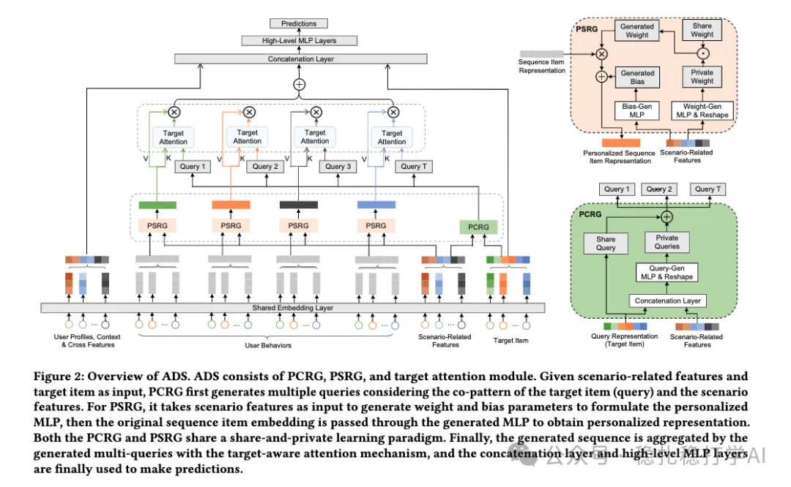

# Recommendation papers (2025.2.11): ByteDance strengthens domain information in behavior sequences for cross-domain modeling
> [中文版](2025-02-11-bytedance-adaptive-domain-scaling.md)

> Source: WeChat post https://mp.weixin.qq.com/s?__biz=MzkzNDYyNjM1NA==&mid=2247484124&idx=1&sn=37480104e408fda8067195db0e0213cb&scene=21#wechat_redirect, published 2025-02-11.
> Split from the roundup "Recommendation algorithms: two industrial-style new results from ByteDance to keep you a step ahead!"; same issue: [ByteDance ADS cross-domain sequence modeling](../cross-domain-recommendation/2025-02-11-bytedance-adaptive-domain-scaling.full.en.md), [ByteDance Large Memory Network](../behavior-sequence-modeling/2025-02-11-bytedance-large-memory-network.full.en.md).

Adaptive Domain Scaling for Personalized Sequential Modeling in Recommenders

Link: https://arxiv.org/pdf/2502.05523

Company: ByteDance

Area: cross-domain + behavior sequence

Overview:

In cross-domain modeling, the innovation is on the behavior sequence: increase the influence of domain (scenario) information on both the target item and the sequence items.

After the target item goes through the PCRG network shown in the figure below, the domain information is fully blended into the generated query embedding, so the query becomes strongly domain-aware.

The sequence items are handled similarly, with domain information blended in. There are some small tricks along the way, such as bias handling, introducing a dynamic network, and T attention networks sharing weights. These are minor embellishments.

Takeaways:

(1) The basic idea is: whatever matters, emphasize it. It is the deployment of a simple, plain idea.

(2) Doing attention several times borrows the multi-head idea from the Transformer.

(2) It borrows a dynamic network to achieve personalization.

Credibility: production

Recommendation: worth reading

