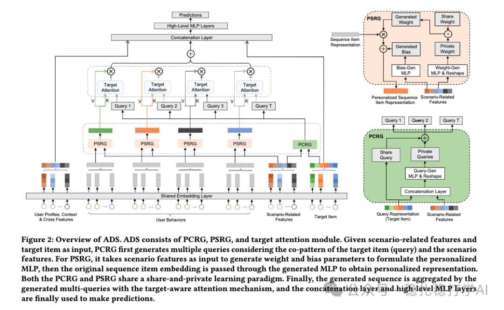

# 推荐算法(2025.2.11)：字节在行为序列上强化场景信息做跨域建模

> 原文：https://mp.weixin.qq.com/s?__biz=MzkzNDYyNjM1NA==&mid=2247484124&idx=1&sn=37480104e408fda8067195db0e0213cb&scene=21#wechat_redirect
> 作者：算法工程师刘明星（稳扎稳打学AI）| 发表于 2025-02-11
> 本文拆自《推荐算法：字节两篇工业风的最新研究成果，助你领先一步！》，同期 2 篇：[字节 ADS 跨域序列建模](../cross-domain-recommendation/2025-02-11-bytedance-adaptive-domain-scaling.md)、[字节 Large Memory Network](../behavior-sequence-modeling/2025-02-11-bytedance-large-memory-network.md)。

关注我，每天为你精挑细选最优质、最新鲜的推荐算法paper，陪你一起保持进步、不断精进！

> [English version](2025-02-11-bytedance-adaptive-domain-scaling.full.en.md)

Adaptive Domain Scaling for Personalized Sequential Modeling in Recommenders

网址：https://arxiv.org/pdf/2502.05523

公司：字节

方向：跨域+行为序列

解读：

在跨域建模时，在行为序列上的创新——将场景的信息分别在target item和sequence item上加大影响。

target item经过如下图的PCRG网络处理后，场景信息充分融入到生成的query embed，从而实现了对场景有强烈感知的。

seq item类似的，将场景信息融入了。在其中，有一些小的trick，如做了bias处理，引入dynamic network，还有T个attention处理网络share weights等。这些是一的小的点缀。

心得：

（1）基本idea就是什么重要，强调什么。算是一个朴素的想法的落地。

（2）多次做attention，是借用了transformer的multi-head思想。

（2）借用了dynamic network，实现个性化。

可信度：生产

推荐等级：推荐看看

