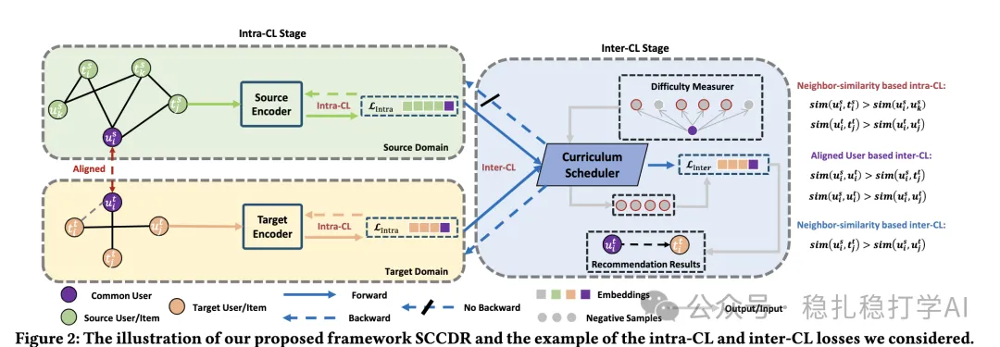

# Recommendation papers (2025.2.25): Huawei SCCDR separates intra-domain and cross-domain contrastive learning, with curriculum scheduling, for cross-domain matching
> [中文版](2025-02-25-huawei-separated-contrastive-cdr.md)

> Source: WeChat post https://mp.weixin.qq.com/s?__biz=MzkzNDYyNjM1NA==&mid=2247484189&idx=1&sn=c256db252d5aa7ce3629b8c45953a2d5&scene=21#wechat_redirect, published 2025-02-25.
> Split from the roundup "Recommendation papers, fast! The latest practical results from four big companies"; same issue: [Meta unified semantic and ID representation](../sid/2025-02-25-meta-unified-semantic-id.full.en.md), [Google LR-Recsys contrastive explanations](../llm4rec/2025-02-25-google-llm-contrastive-explanations.full.en.md), [Huawei SCCDR cross-domain contrastive learning](../cross-domain-recommendation/2025-02-25-huawei-separated-contrastive-cdr.full.en.md), [Alibaba ESANS semantic-aware negative sampling](../deep-retrieval/2025-02-25-ali-esans-negative-sampling.full.en.md).

Intro of this issue:

This post focuses on frontier research in recommender systems, covering LLM recommendation, cross-domain recommendation, and embedding-based retrieval. It walks through four papers from well-known companies and gives takeaways and recommendation levels.

Separated Contrastive Learning for Matching in Cross-domain Recommendation with Curriculum Scheduling

Link: https://arxiv.org/pdf/2502.16239

Company: Huawei

Area: cross-domain recommendation

Overview: A paradigm that separates intra-domain and cross-domain contrastive learning: it proposes the SCCDR framework, which separates intra-domain contrastive learning from cross-domain contrastive learning to improve generalization and keep the model from becoming biased toward one domain in cross-domain recommendation.

Curriculum scheduling: it introduces a curriculum-based scheduling mechanism that trains from easy to hard, improving learning efficiency and quality and reducing negative transfer in cross-domain recommendation.

Credibility: production

Recommendation: worth reading

