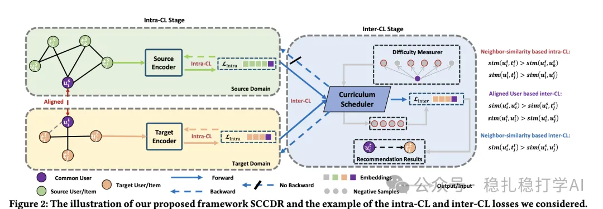

# 推荐算法(2025.2.25)：华为 SCCDR 分离域内与跨域对比学习，配合课程调度做跨域召回

> 原文：https://mp.weixin.qq.com/s?__biz=MzkzNDYyNjM1NA==&mid=2247484189&idx=1&sn=c256db252d5aa7ce3629b8c45953a2d5&scene=21#wechat_redirect
> 作者：算法工程师刘明星（稳扎稳打学AI）| 发表于 2025-02-25
> 本文拆自《推荐算法paper速冲！四大厂最新实用科技成果》，同期 4 篇：[Meta 语义与 ID 统一表征](../sid/2025-02-25-meta-unified-semantic-id.md)、[Google LR-Recsys 对比解释](../llm4rec/2025-02-25-google-llm-contrastive-explanations.md)、[华为 SCCDR 跨域对比学习](../cross-domain-recommendation/2025-02-25-huawei-separated-contrastive-cdr.md)、[阿里 ESANS 语义感知负采样](../deep-retrieval/2025-02-25-ali-esans-negative-sampling.md)。

关注我，每天为你精挑细选最优质、最新鲜的推荐算法paper，陪你一起保持进步、不断精进！

> [English version](2025-02-25-huawei-separated-contrastive-cdr.full.en.md)

当期前言：

这篇文章主要聚焦于推荐系统领域的前沿研究，涉及 LLM 推荐、跨域推荐和向量召回等方向，解读了四篇来自知名企业的论文，并给出了心得和推荐等级。

Separated Contrastive Learning for Matching in Cross-domain Recommendation with Curriculum Scheduling

网址：https://arxiv.org/pdf/2502.16239

公司：华为

方向：跨域推荐

解读：分离域内和跨域对比学习范式：提出 SCCDR 框架，将域内对比学习和跨域对比学习分离，以增强模型的泛化能力，避免在跨域推荐中出现模型学习偏向某个领域的现象。

课程调度机制：引入了基于课程的调度机制，通过先简单后复杂的训练方式提高学习效率和效果，减少了跨域推荐中的负迁移问题。

可信度：生产

推荐等级：推荐看看

