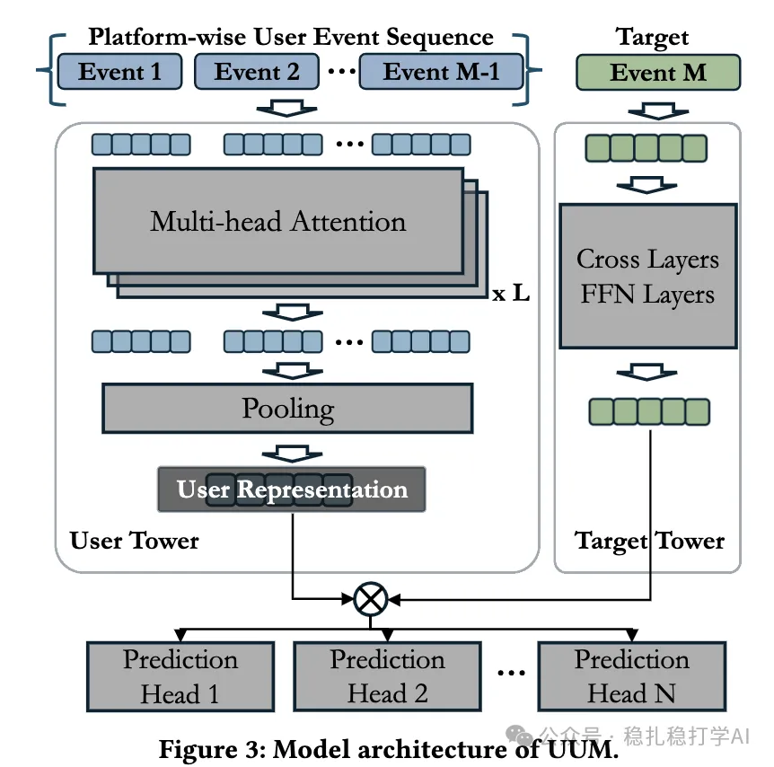

# Recommendation papers (2025.5.1): Snap's cross-domain user representation learning

> [中文版](2025-05-01-snap-uum.md)

1 UUM: A Unified User Model for Snap's User Modeling

Link: https://arxiv.org/pdf/2504.16966

Company: Snap

Area: cross-domain user representation

Overview: this method models user behavior across domains in a unified way, learns a cross-domain user representation, and applies it to different tasks.

Core method:

(1) Data generation: combine user event data from domains such as content (long-form video), ads and lenses, organize it into sequences by user ID, sort by timestamp, cap sequence length at 5000, and keep high-intent events. High-intent events usually mean actions in the user's interaction with the platform that show strong interest or a clear purpose; these better reflect the user's preferences and intent.

(2) Model training: pretrain with self-supervised learning (SSL) to learn user representations, then fine-tune with supervised learning (SL) to optimize them.

(3) Multi-task learning: apply the user representation to different tasks, including click-through rate prediction, watch time estimation, purchase rate prediction, etc.

A/B: in online A/B tests, UUM's representation learning brought clear gains: click-through rate +0.23%, engagement rate +0.46%.

Takeaways:

(1) Cross-domain user representation learning is a very promising direction.

(2) UUM's core innovation is modeling user behavior from different domains in a unified way, achieving efficient cross-domain user representation learning.

Credibility:

Recommendation: worth a look

