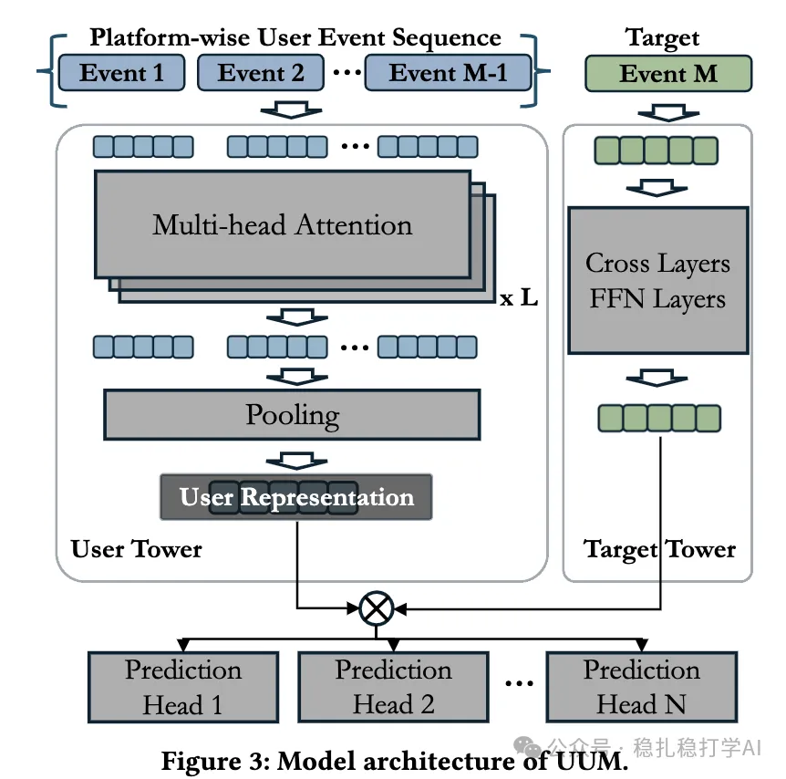

# 推荐算法(2025.5.1)：Snap的跨域用户表征学习

> 原文：https://mp.weixin.qq.com/s?__biz=MzkzNDYyNjM1NA==&mid=2247484613&idx=1&sn=02d4e14ae3ed05a4602f809d48db6590&scene=21#wechat_redirect
> 作者：算法工程师刘明星（稳扎稳打学AI）| 发表于 2025-05-01

嘿，记得给“稳扎稳打学AI”添加星标

关注我，每天为你精挑细选最优质、最新鲜的推荐算法paper，陪你一起保持进步、不断精进！

📄 [本公众号paper推荐原则](https://mp.weixin.qq.com/s?__biz=MzkzNDYyNjM1NA==&mid=2247484097&idx=1&sn=18322c279290b555eb030e12953b7c7f&scene=21#wechat_redirect)

1 UUM: A Unified User Model for Snap's User Modeling

网址：https://arxiv.org/pdf/2504.16966

公司：Snap

方向：跨域用户表征

解读：这个方法是将跨域用户行为统一建模，学习一个跨域用户表征，并将其应用于不同的任务。

核心方法：

（1）数据生成：整合来自内容（长视频）、广告、镜头等域的用户事件数据，按用户ID组织成序列，时间戳排序，限制序列长度为5000，保留高意图事件。其中，高意图事件通常指用户与平台交互中表现出较强兴趣或明确目的的行为，这些行为更能反映用户的偏好和意图。

（2）模型训练：利用自监督学习（SSL）预训练，学习用户表征。然后，通过监督学习（SL）微调，优化用户表征。

（3）多任务学习：将用户表征应用于不同的任务，包括点击率预测、观看时间估计、购买率预测等。

AB：线上AB实验中，UUM的表征学习能力显著提升，具体包括：点击率提升了0.23%，互动率提升了0.46%。

心得：

（1）跨域用户表征学习是一个非常有前景的方向。

（2）UUM的核心创新在于将不同域的用户行为统一建模，实现了高效的跨域用户表征学习。

可信度：

推荐等级：值得看看

请帮忙点赞、转发，谢谢。您认为哪篇论文最有潜力应用到实际业务中？

## 欢迎干货投稿 \ 论文宣传 \ 合作交流

推荐您继续阅读：

■ [推荐算法(2025.4.29)：美团的行为序列效果增强方法](https://mp.weixin.qq.com/s?__biz=MzkzNDYyNjM1NA==&mid=2247484607&idx=1&sn=ebcf93dd74a44fd9c0c9eaae9e6c3713&scene=21#wechat_redirect)

■ [推荐算法(2025.4.28)：快手、Pinterest的满满工业风成果](https://mp.weixin.qq.com/s?__biz=MzkzNDYyNjM1NA==&mid=2247484600&idx=1&sn=20790b6a927172aeb58c03d084de83e9&scene=21#wechat_redirect)

■ [推荐算法周报(2025.4.26)：华为、快手、meta的最新工作](https://mp.weixin.qq.com/s?__biz=MzkzNDYyNjM1NA==&mid=2247484586&idx=1&sn=e1a1cb251d46b89a7b5f66a31bc4e926&scene=21#wechat_redirect)

历史文章索引：https://docs.qq.com/sheet/DYXZTZ0tseHRyZGtt?tab=BB08J2

由于公众号试行乱序推送，您可能不再准时收到稳扎稳打学AI的推送。为了第一时间收到本号的干货内容，请将本号设为星标，以及常点文末右下角的“在看”。

喜欢的话点个在看吧👇

个人观点，仅供参考
