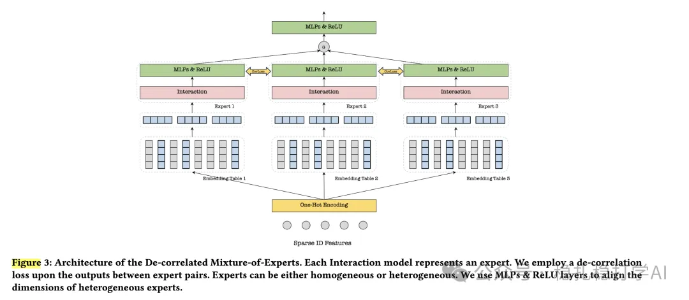

# Recommendation papers (2025.5.26): Meituan De-MoE, decoupling task experts with a de-correlation constraint
> [中文版](2025-05-26-meituan-decorrelated-moe.md)

> Source: WeChat post https://mp.weixin.qq.com/s?__biz=MzkzNDYyNjM1NA==&mid=2247484696&idx=1&sn=52a577d039ccc497941425043935fc25&scene=21#wechat_redirect, published 2025-05-26.
> Split from the roundup "Recommendation papers (2025.5.26): Tencent and Meituan with significant A/B gains"; same issue: [Tencent multi-head decoupled MoE](../cross-domain-recommendation/2025-05-26-tencent-multi-head-decoupled-moe.full.en.md), [Meituan de-correlated MoE](../cross-domain-recommendation/2025-05-26-meituan-decorrelated-moe.full.en.md).

De-correlated Mixture-of-Experts for Cross-Domain Recommendation

Link: https://arxiv.org/pdf/2505.13905

Company: Meituan

Area: multi-task

Overview: In multi-task MoE, each task has its own mixture of experts, and sharing bottom experts mixes information across tasks. So the paper designs De-MoE with decoupled experts, to decouple each task's experts, and uses a de-correlation constraint to keep expert information from mixing across tasks.

The core of the method is to split the MoE structure by task into multiple sub-experts and introduce a de-correlation constraint that prevents experts of different tasks from learning overlapping information. This lets tasks cooperate better, avoids negative transfer, and improves sharing efficiency across tasks.

A/B: in online A/B tests in the WeChat Ads scenario, multiple scenarios (such as Channel pCTR, Moments pCTR) improved significantly, and A/B tests in multiple Meituan scenarios brought GMV gains, covering ads, recommendation and other business scenarios. Multiple scenarios (such as Channel pCTR, Moments pCTR) all improved significantly.

Takeaways:

(1) The core ideas of the two papers are very close, and each can borrow from the other.

(2) Decoupling tasks is an effective way to address negative transfer.

Credibility: production

Recommendation: has practical value

