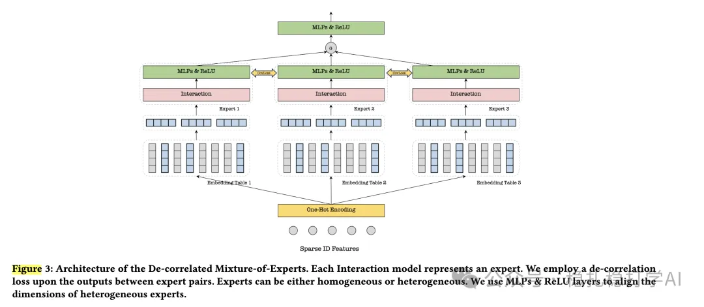

# 推荐算法(2025.5.26)：美团De-MoE，用去相关约束解耦任务专家

> 原文：https://mp.weixin.qq.com/s?__biz=MzkzNDYyNjM1NA==&mid=2247484696&idx=1&sn=52a577d039ccc497941425043935fc25&scene=21#wechat_redirect
> 作者：算法工程师刘明星（稳扎稳打学AI）| 发表于 2025-05-26
> 本文拆自《推荐算法(2025.5.26)：腾讯、美团的AB效果显著》，同期 2 篇：[腾讯多头解耦 MoE](../cross-domain-recommendation/2025-05-26-tencent-multi-head-decoupled-moe.md)、[美团去相关 MoE](../cross-domain-recommendation/2025-05-26-meituan-decorrelated-moe.md)。

关注我，每天为你精挑细选最优质、最新鲜的推荐算法paper，陪你一起保持进步、不断精进！

> [English version](2025-05-26-meituan-decorrelated-moe.full.en.md)

De-correlated Mixture-of-Experts for Cross-Domain Recommendation

网址：https://arxiv.org/pdf/2505.13905

公司：美团

方向：多任务

解读：多任务的MoE是每个任务各自的专家混合体，共享底层专家会导致任务间信息的混杂，因此用一个解耦专家设计了De-MoE，用来把各任务的专家解耦，并用去相关约束来防止任务间专家信息的混杂。

方法核心是将MoE结构按任务拆分成多个子专家，并引入去相关约束，防止任务间专家学习到重叠信息，使得任务间可以更好地协作，避免负迁移，提高任务间的共享效率。

AB：线上AB实验，在微信广告场景下，多个场景（如Channel pCTR、Moments pCTR）均显著提升，并在美团多个场景的AB实验中取得GMV提升，覆盖广告、推荐等多个业务场景。在多个场景（如Channel pCTR、Moments pCTR）均显著。

心得：

（1）两篇paper的核心思想非常接近，可以相互借鉴。

（2）任务间的解耦是解决负迁移的有效方法。

可信度：生产

推荐等级：有实践价值

