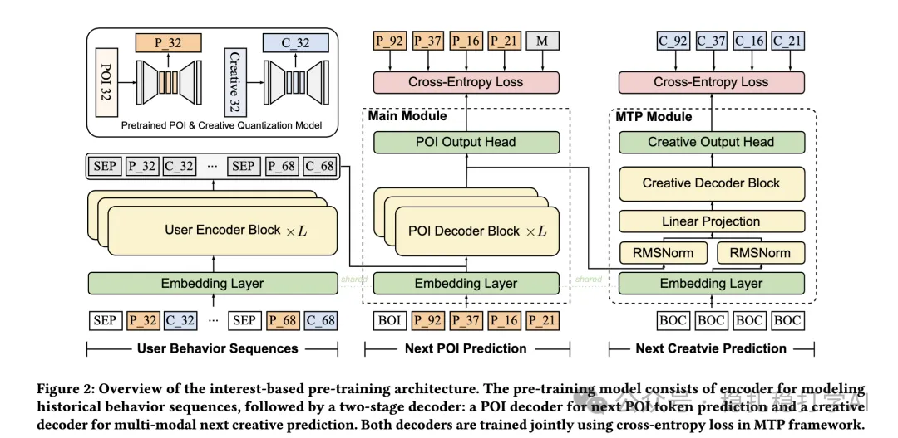

# Recommendation papers (2025.5.26): Tencent WeChat Ads multi-head decoupled MoE to reduce cross-domain negative transfer
> [中文版](2025-05-26-tencent-multi-head-decoupled-moe.md)

> Source: WeChat post https://mp.weixin.qq.com/s?__biz=MzkzNDYyNjM1NA==&mid=2247484696&idx=1&sn=52a577d039ccc497941425043935fc25&scene=21#wechat_redirect, published 2025-05-26.
> Split from the roundup "Recommendation papers (2025.5.26): Tencent and Meituan with significant A/B gains"; same issue: [Tencent multi-head decoupled MoE](../cross-domain-recommendation/2025-05-26-tencent-multi-head-decoupled-moe.full.en.md), [Meituan de-correlated MoE](../cross-domain-recommendation/2025-05-26-meituan-decorrelated-moe.full.en.md).

Multi-Head Decoupled Mixture-of-Experts for Cross-Domain Recommendation

Link: https://arxiv.org/pdf/2505.13904

Company: Tencent WeChat Ads

Area: multi-task

Overview: In multi-task learning, a shared bottom helps with shared information, but tasks also conflict with each other. To maximize the benefit of cross-domain multi-task joint modeling, the paper targets the features of different domains and uses a multi-head MoE to reduce negative transfer between domains.

The core of the method is a multi-head MoE architecture that integrates intra-domain and inter-domain information for the tasks and makes full use of both. By decoupling the tasks, it mitigates negative transfer between tasks.

A/B: in the online A/B test, GMV rose 1.53% in the WeChat Moments scenario and 1.15% in the WeChat Channels scenario.

Takeaways:

(1) In multi-task learning, features can be shared, but they can also be combined in different ways depending on the objective.

Credibility: production

Recommendation: has practical value

