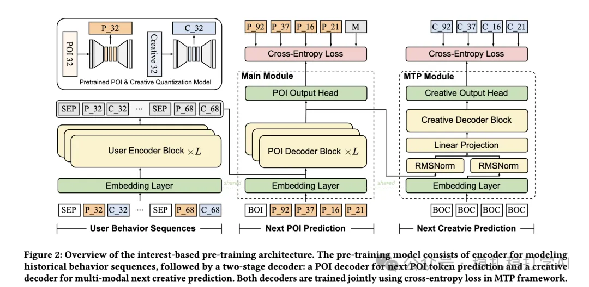

# 推荐算法(2025.5.26)：腾讯微信广告多头解耦MoE，缓解跨域负迁移

> 原文：https://mp.weixin.qq.com/s?__biz=MzkzNDYyNjM1NA==&mid=2247484696&idx=1&sn=52a577d039ccc497941425043935fc25&scene=21#wechat_redirect
> 作者：算法工程师刘明星（稳扎稳打学AI）| 发表于 2025-05-26
> 本文拆自《推荐算法(2025.5.26)：腾讯、美团的AB效果显著》，同期 2 篇：[腾讯多头解耦 MoE](../cross-domain-recommendation/2025-05-26-tencent-multi-head-decoupled-moe.md)、[美团去相关 MoE](../cross-domain-recommendation/2025-05-26-meituan-decorrelated-moe.md)。

关注我，每天为你精挑细选最优质、最新鲜的推荐算法paper，陪你一起保持进步、不断精进！

> [English version](2025-05-26-tencent-multi-head-decoupled-moe.full.en.md)

Multi-Head Decoupled Mixture-of-Experts for Cross-Domain Recommendation

网址：https://arxiv.org/pdf/2505.13904

公司：腾讯微信广告

方向：多任务

解读：多任务中共享底座对共享的信息很有帮助，但是任务间也存在冲突。为了实现跨领域的多任务联合建模效果最大化，针对不同的领域的特征，通过多头的MoE来降低不同领域间的负迁移。

方法核心是设计了多头的MoE架构，来实现对任务域内与域间信息的整合，并对域内、域间的信息进行了充分利用。通过将任务解耦，从而能够缓解任务间的负迁移问题。

AB：线上AB实验中，微信Moments场景下的GMV提升了1.53%，微信Channels场景下GMV提升了1.15%。

心得：

（1）多任务中，特征可以共享，但也可以根据目标的不同，有不同的组合方式。

可信度：生产

推荐等级：有实践价值

