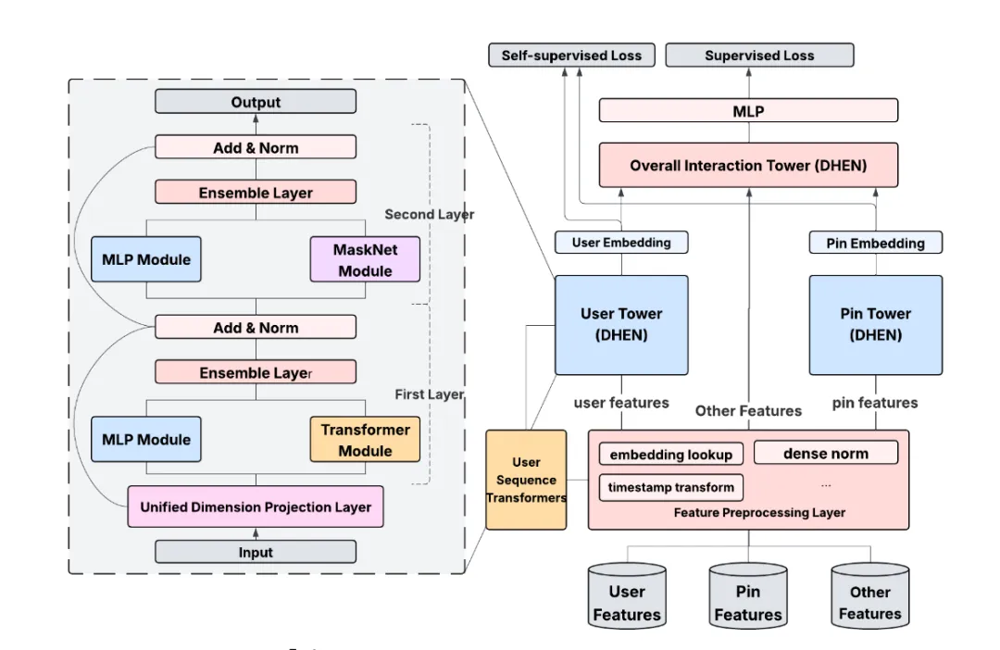

# Recommendation papers (2025.9.7): Pinterest's cross-domain representation learning

> [中文版](2025-09-06-pinterest-decoupled-representation.md)

1 Decoupled Entity Representation Learning for Pinterest Ads Ranking

Link: https://arxiv.org/pdf/2509.04337

Company: Pinterest

Area: cross-domain representation learning

Overview: combine data from multiple businesses and surfaces to train a model that produces CTR- (or CVR-) oriented user and item representations; these representations can be used in retrieval and ranking models to improve recommendation quality. The representation model is computed offline daily, and the result is averaged with weights with the previous day's result to give the final embedding.

(1) Unified modeling

1) Model structure. A multi-tower model separately models users, items and other features. Specifically: the user tower models user features, the item tower models item features, and other towers model other features.

2) Feature processing. Features from different businesses and surfaces are unified into one feature space. Specifically: features from different businesses and surfaces are mapped into a unified feature space through a mapping network.

(2) Self-supervised tasks

1) Contrastive learning. The model is trained with contrastive learning. Specifically: different actions of the same user are positives; actions of different users are negatives; through contrastive learning, the model learns user representations.

2) Masked prediction. The model is trained with masked prediction. Specifically: some actions in the user behavior sequence are masked, and the model predicts the masked actions; through masked prediction, the model learns patterns of user behavior.

Takeaways: (1) Training entity representations and adding them to the main recommendation model achieves knowledge injection and improves the recommendation model. In particular, representations trained across multiple business surfaces achieve cross-domain knowledge transfer. Pinterest has recently published several papers that achieve knowledge transfer in different ways; this direction is worth watching.

Credibility: production

Recommendation: practically useful

