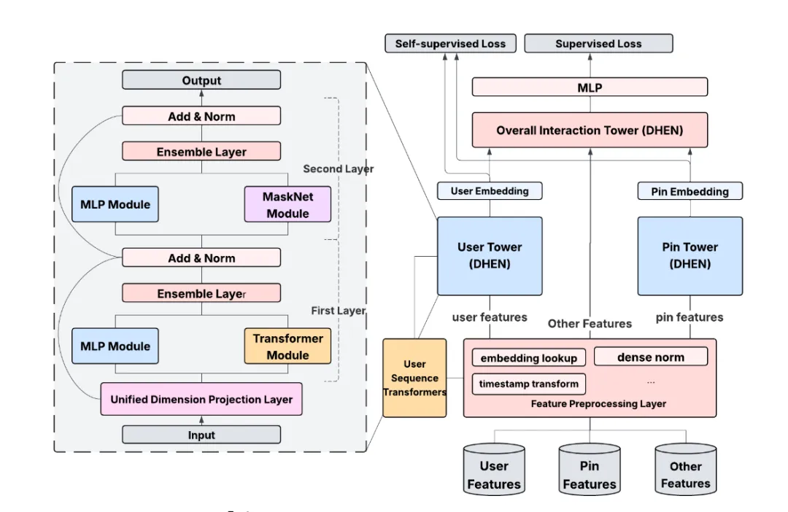

# 推荐算法(2025.9.7)：Pinterest的跨域表征学习

> 原文：https://mp.weixin.qq.com/s/hI3B6ZefpBDRnsuuHIiRNw
> 作者：算法工程师刘明星（稳扎稳打学AI）| 发表于 2025-09-06

嘿，记得给“稳扎稳打学AI”添加星标

关注我，每天为你精挑细选最优质、最新鲜的推荐算法paper，陪你一起保持进步、不断精进！

👆 [本公众号paper推荐原则](https://mp.weixin.qq.com/s/BhVGu0qH5kTz9N5zpsD3KA)

1 Decoupled Entity Representation Learning for Pinterest Ads Ranking

网址：https://arxiv.org/pdf/2509.04337

公司：Pinterest

方向：跨域表征学习

解读：整合多个业务、场景的数据，训练一个可以获取CTR（或者CVR）方面的user、item表征的模型，这些表征可以用于召回、排序模型，提高推荐效果。表征模型，每天离线计算，与昨天的计算结果，通过加权平均求和，作为最终的嵌入。

（1）统一建模

1）模型结构。用一个多塔模型，分别对user、item、其它特征进行建模。具体的：user塔对用户特征进行建模，item塔对物品特征进行建模，其它塔对其它特征进行建模。

2）特征处理。将不同业务、场景的特征，统一到一个特征空间中。具体的：将不同业务、场景的特征，通过一个映射网络，映射到统一的特征空间中。

（2）自监督任务

1）对比学习。用对比学习的方法，训练模型。具体的：将同一个用户的不同行为，作为正样本；将不同用户的行为，作为负样本；通过对比学习，让模型学习到用户的表征。

2）掩码预测。用掩码预测的方法，训练模型。具体的：将用户行为序列中的部分行为掩码掉，让模型预测被掩码的行为；通过掩码预测，让模型学习到用户行为的模式。

心得：（1）训练entity的表征，加入到主推荐模型，实现了知识注入，提升了推荐模型的效果。特别是通过多个业务场景训练的表征，实现了跨域知识迁移的效果。最近Pinterest已经发布了多篇paper，用不同的方法，实现了知识迁移，这个方向值得关注。

可信度：生产

推荐等级：有实践价值

请帮忙点赞、转发，谢谢。您认为哪篇论文最有潜力应用到实际业务中？

## 欢迎干货投稿 \ 论文宣传 \ 合作交流

推荐您继续阅读：

■ [推荐算法(2025.9.4)：快手的MTL新方法，有效果](https://mp.weixin.qq.com/s/y7uWpkrDDdlekri6P-xtQg)

■ [推荐算法(2025.9.3)：美团通过码本压缩长行为序列，有不错效果](https://mp.weixin.qq.com/s/i6mzrdDVh1kJXUh5g3nMVw)

历史文章索引：https://docs.qq.com/sheet/DYXZTZ0tseHRyZGtt?tab=BB08J2

请入微信群，群内我会给出更深入的解读，还可以共同讨论技术方案、发招聘广告、内推和交友等。

• 铁粉标准：关注一个月以上，且累计10次互动（评论、爱心、转发）、或投稿1次。

• 入群方法：请您加个人微信lmxhappy，我拉您入群，请备注（只我个人看，不公开）。

喜欢的话点个在看吧👇

个人观点，仅供参考
