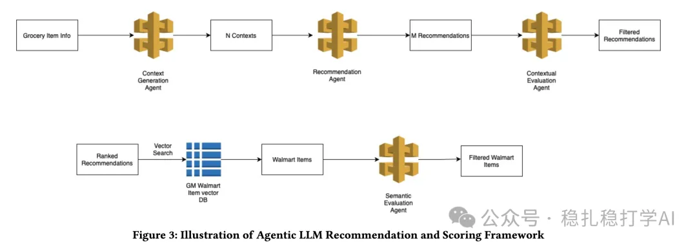
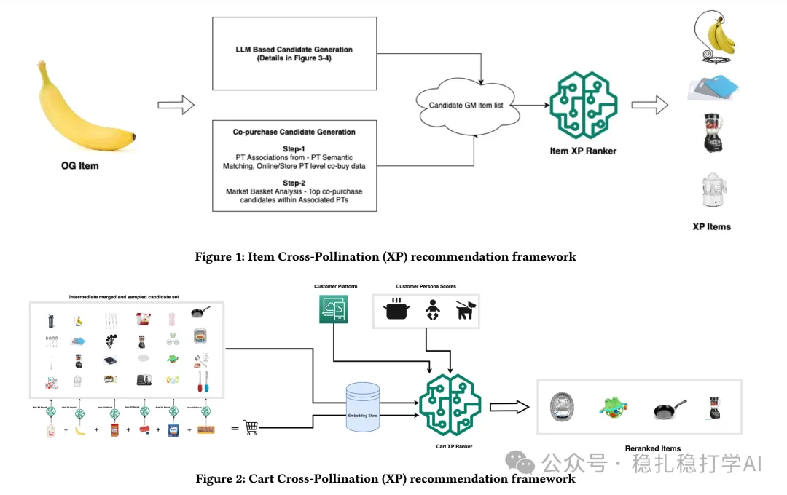

# Recommendation papers (2025.9.8): Walmart's LLM cross-domain recommendation, add-to-cart rate +36%

> [中文版](2025-09-08-walmart-llm-cross-domain.md)

1 Grocery to General Merchandise: Enhancing Cross-Category Recommendations with Large Language Models

Link: https://arxiv.org/pdf/2509.02890

Company: Walmart

Area: cross-domain + LLM

Overview: the paper mainly describes how Walmart uses LLMs for cross-domain recommendation. Specifically:

(1) Retrieval

Use an LLM to generate candidate products, then filter candidates with semantic search and dual evaluation. Specifically: an LLM generates candidate products, then an LLM contextual evaluation agent evaluates (anchor, recommendation, explanation) triples, scoring them on cross-category discovery, relevance, explanation quality and purchase likelihood. Recommendations scoring <0.4 are filtered out. Candidates are then filtered further with semantic search (E5 embedding model) and dual evaluation (LLM-as-Judge and Cross-Encoder).

(2) Ranking

An MLP model ranks the candidate products. Specifically: an MLP model ranks the candidate products. A Transformer encodes the items in the user's cart, and cross-attention is done between the cart items and the candidate item. These two encoding results, together with other features, go into the MLP to model purchase likelihood.

A/B: at Walmart, add-to-cart rate +36% over the baseline.

Takeaways: (1) The paper uses an LLM's strength about the world, its understanding ability, to achieve cross-domain retrieval. (2) This is cart2item recommendation, an upgraded version of item2item recommendation, which is itself a traditional recommendation method and direction.

Credibility: production

Recommendation: practically useful

