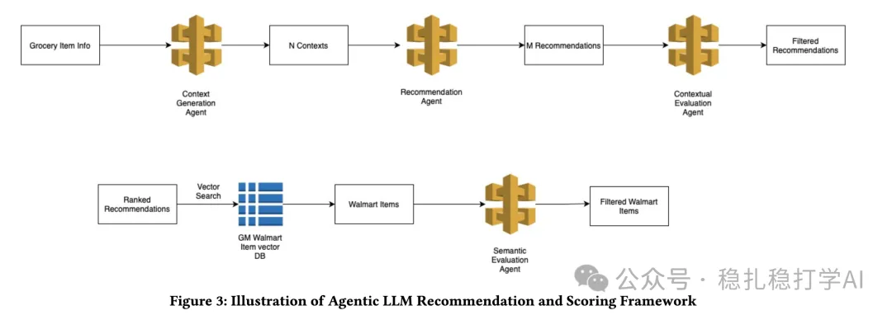
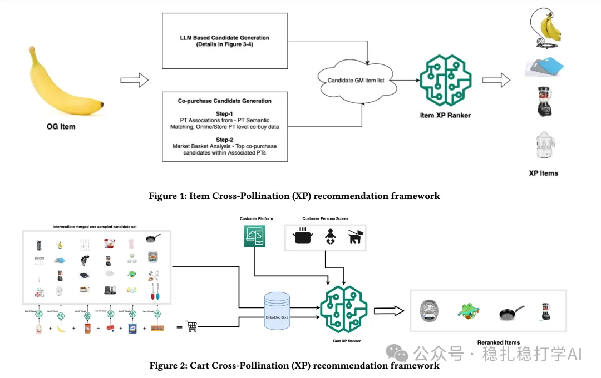

# 推荐算法(2025.9.8)：沃尔玛的LLM跨域推荐，加购率提升36%

> 原文：https://mp.weixin.qq.com/s/mPINikAfsneS7MFu8OmjWQ
> 作者：算法工程师刘明星（稳扎稳打学AI）| 发表于 2025-09-08

嘿，记得给“稳扎稳打学AI”添加星标

关注我，每天为你精挑细选最优质、最新鲜的推荐算法paper，陪你一起保持进步、不断精进！

> [English version](2025-09-08-walmart-llm-cross-domain.full.en.md)

👆 [本公众号paper推荐原则](https://mp.weixin.qq.com/s/BhVGu0qH5kTz9N5zpsD3KA)

1 Grocery to General Merchandise: Enhancing Cross-Category Recommendations with Large Language Models

网址：https://arxiv.org/pdf/2509.02890

公司：沃尔玛

方向：跨域+LLM

解读：本文主要介绍了沃尔玛如何用LLM做跨域推荐。具体的：

（1）召回

用LLM生成候选商品，再通过语义搜索和双重评估过滤候选。具体的：用LLM生成候选商品，再通过LLM上下文评估代理——评估（锚、推荐、解释）三元组，按跨类别发现、相关性、解释质量、购买可能性打分。过滤分数<0.4的推荐。再通过语义搜索（E5嵌入模型）和双重评估（LLM-as-Judge和Cross-Encoder）过滤候选。

（2）排序

用一个MLP模型，对候选商品做排序。具体的：用一个MLP模型，对候选商品做排序。具体通过Transform对user的购物车里的item做encode，对购物车里的item与candidate item做cross-attention。这两个的encode结果再与其它特征，接入MLP做purchase可能性建模。

AB：在沃尔玛上，相比基线，加购率提升36%。

心得：（1）本文利用了大模型对世界的长项——理解能力，实现了跨域的召回。（2）本文是cart2item的推荐，是item2item推荐的升级版本，这个也是一个传统推荐方法和方向了。

可信度：生产

推荐等级：有实践价值

请帮忙点赞、转发，谢谢。您认为哪篇论文最有潜力应用到实际业务中？

## 欢迎干货投稿 \ 论文宣传 \ 合作交流

推荐您继续阅读：

■ [推荐算法(2025.9.7)：Pinterest的跨域表征学习](https://mp.weixin.qq.com/s/hI3B6ZefpBDRnsuuHIiRNw)

■ [推荐算法(2025.9.6)：Meta将graph embed用做序列建模，有明显效果](https://mp.weixin.qq.com/s?__biz=MzkzNDYyNjM1NA==&mid=2247485073&idx=1&sn=1d4e52366303701fefdd66804c33c978&scene=21#wechat_redirect)

历史文章索引：https://docs.qq.com/sheet/DYXZTZ0tseHRyZGtt?tab=BB08J2

请入微信群，群内我会给出更深入的解读，还可以共同讨论技术方案、发招聘广告、内推和交友等。

• 铁粉标准：关注一个月以上，且累计10次互动（评论、爱心、转发）、或投稿1次。

• 入群方法：请您加个人微信lmxhappy，我拉您入群，请备注（只我个人看，不公开）。

喜欢的话点个在看吧👇

个人观点，仅供参考
