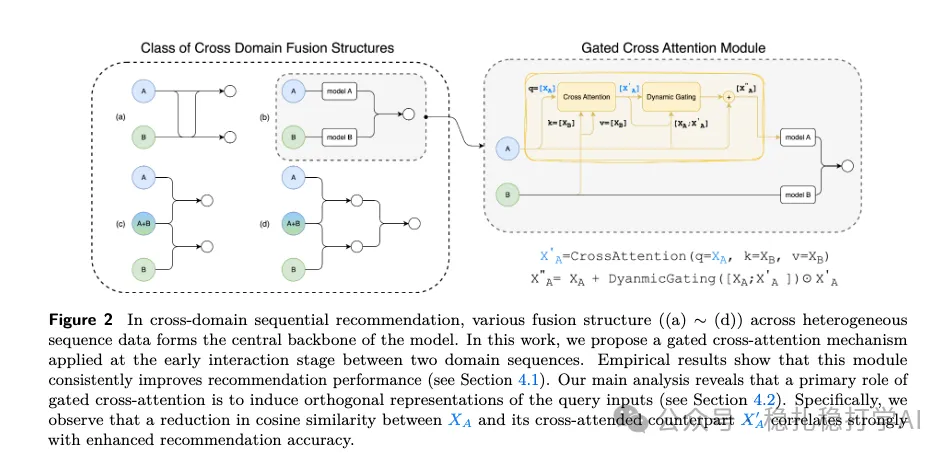

# Recommendation papers (2025.10.14): Meta's cross-domain method, with a thoughtful detailed look at why it works

> [中文版](2025-10-14-meta-gca-cross-domain.md)

1 Cross-attention Secretly Performs Orthogonal Alignment

Link: https://arxiv.org/pdf/2510.09435

Company: Meta

Idea: cross-domain (cross-attention, gating, alignment)

Area: cross-domain sequence modeling

Overview:

The paper proposes a module for cross-domain knowledge transfer and investigates why it works.

The module is called Gated Cross Attention (GCA). It transfers domain B's behavior sequence into domain A. How it works:

(1) Cross-attention module

Cross-attention with A as the query and B as the key and value. The output sequence has the same length as A.

(2) Gating network

A position-wise DNN. A's and B's behavior sequences are concatenated position by position, from shapes (b, LA, d) and (b, LB, d) into shape (b, max(LA, LB), 2d). Then the DNN scales it to shape (b, max(LA, LB), d). The first LA outputs of the output sequence are kept. This is so it can take a Hadamard product with the result of (1), which requires equal lengths.

(3) Fusion

The output of (1) and the gate values from (2) are multiplied with a Hadamard product, then added to A's own behavior sequence, giving the enhanced A behavior sequence.

Why it works: the paper runs detailed experiments to investigate why GCA works. Specifically:

1) Orthogonal alignment. The cross-attention output is orthogonally aligned with A's behavior sequence, which can be understood as: the cross-attention output is at a 90-degree angle to A's behavior sequence, so the cross-attention output does not interfere with A's behavior sequence.

2) Gating mechanism. The gating mechanism controls how much the cross-attention output affects A's behavior sequence. Specifically: the larger the gate value, the more the cross-attention output affects A's behavior sequence; the smaller the gate value, the less it does.

3) Experimental validation. The paper runs many experiments validating the effectiveness of orthogonal alignment and the gating mechanism. Specifically: on multiple datasets, GCA achieves the best results.

Takeaways: (1) The idea is very simple and direct: use a cross-attention module and a gating mechanism to achieve cross-domain knowledge transfer. The benefit of this approach is that cross-domain knowledge transfer can be achieved without changing the original model structure. (2) The orthogonal alignment and gating mechanism are also well worth borrowing. Orthogonal alignment avoids the cross-attention output interfering with the original sequence, and the gating mechanism controls how much the cross-attention output affects the original sequence.

Caveats: the theoretical analysis in this work is somewhat interesting, but I think if the quality of domain B's sequence is low, GCA's effect may be heavily discounted.

Credibility: offline

Recommendation: practically useful

