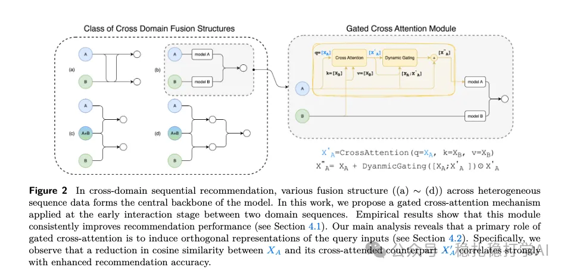

# 推荐算法(2025.10.14)：meta的跨域方法，贴心的详细探讨了生效原理

> 原文：https://mp.weixin.qq.com/s/b2QXIxOtFWNpY95N9_GRAw
> 作者：算法工程师刘明星（稳扎稳打学AI）| 发表于 2025-10-14

嘿，记得给“稳扎稳打学AI”添加星标

关注我，每天为你精挑细选最优质、最新鲜的推荐算法paper，陪你一起保持进步、不断精进！

> [English version](2025-10-14-meta-gca-cross-domain.full.en.md)

👆 [本公众号paper推荐原则](https://mp.weixin.qq.com/s/BhVGu0qH5kTz9N5zpsD3KA)

1 Cross-attention Secretly Performs Orthogonal Alignment

网址：https://arxiv.org/pdf/2510.09435

公司：meta

思想：跨域（交叉注意力、门控、对齐）

方向：跨域序列建模

解读：

本文提出了一种跨域知识迁移的模块，并探讨了其work的原因。

模块叫门控跨注意力模块（Gated Cross Attention, GCA），实现了领域B的行为序列，迁移到领域A的目的，具体原理：

（1）跨注意力模块

A做query，B做value和key的，cross-attention。输出的序列长度，同A。

（2）门控网络

是一个position-wise的DNN网络。即将A的行为序列和B的，一一对应拼接，从shape（b，LA，d)，(b,LB,d)，拼接成shape（b,max(LA,LB),2d)。然后经过DNN，缩放到shape(b, max((LA,LB),d)。截取输出序列前LA个输出。这是为了与（1）的结果做hadamard积，要求等长。

（3）融合

将（1）得到的输出，和（2）得到的gate值做hadamard积，与A本身的行为序列做加和，得到增强后的A行为序列。

原理：本文做了详细的实验，探讨了GCA的work原因。具体的：

1）正交对齐。cross-attention的输出，与A的行为序列做正交对齐，可以理解为：cross-attention的输出，与A的行为序列的夹角为90度，从而避免了cross-attention的输出对A的行为序列的干扰。

2）门控机制。门控机制可以控制cross-attention的输出对A的行为序列的影响程度。具体的：门控值越大，cross-attention的输出对A的行为序列的影响越大；门控值越小，cross-attention的输出对A的行为序列的影响越小。

3）实验验证。本文做了大量的实验，验证了正交对齐和门控机制的有效性。具体的：在多个数据集上，GCA都取得了最好的效果。

心得：（1）本文的思路非常简单直接：用跨注意力模块和门控机制，实现跨域知识迁移。这种方法的好处是：可以在不改变原有模型结构的情况下，实现跨域知识迁移。（2）本文的正交对齐和门控机制也非常值得借鉴。正交对齐可以避免cross-attention的输出对原有序列的干扰，而门控机制可以控制cross-attention的输出对原有序列的影响程度。

愚见：这个work的理论分析有点意思，但是我觉得，如果B域的序列质量不高，那么GCA的效果可能会大打折扣。

可信度：离线

推荐等级：有实践价值

请帮忙点赞、转发，谢谢。

## 欢迎干货投稿 \ 论文宣传 \ 合作交流

推荐您继续阅读：

■ [推荐算法(2025.10.10)：谷歌的，用LLM给短视频打标签的工业落地方案](https://mp.weixin.qq.com/s/o2WlE_W2lAX8mMEq_02g0A)

■ [推荐算法(2025.10.9)：Snap说：做GR推荐的同行们，你们走错方向了](https://mp.weixin.qq.com/s/2G3-Moegkx5x8f0Yt0gCVw)

历史文章索引：https://docs.qq.com/sheet/DYXZTZ0tseHRyZGtt?tab=BB08J2

请入微信群，群内我会给出更深入的解读，还可以共同讨论技术方案、发招聘广告、内推和交友等。

• 铁粉标准：关注公众号一个月以上，且在公众号上累计15次互动（评论、爱心、转发）、或投稿1次。

• 入群方法：请您加个人微信lmxhappy，我拉您入群，请备注（只我个人看，不公开）。

喜欢的话点个在看吧👇

个人观点，仅供参考
