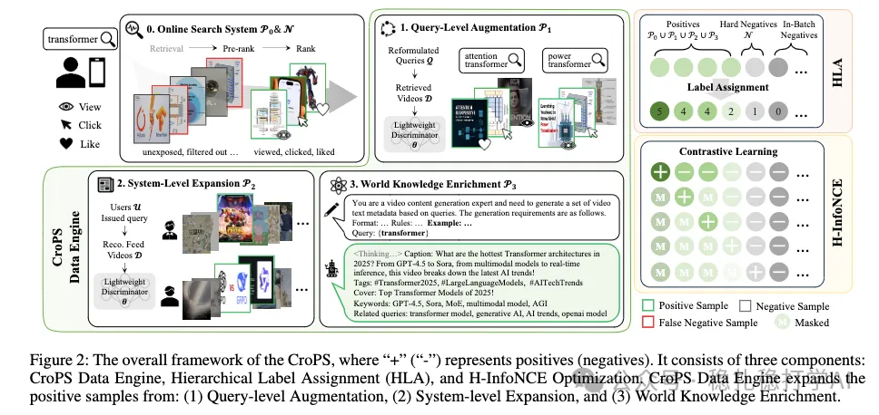

# Daily pick (2025.11.21): Kuaishou, EBR retrieval, a really thorough hunt for positive samples

> [中文版](2025-11-21-kuaishou-crops-ebr.md)

1 CroPS: Cross-Scenario Positive Sample Enrichment for EBR

Link: https://arxiv.org/pdf/2511.18008

Company: Kuaishou

Idea: finding the full set of samples

Area: retrieval + EBR + negative samples

Overview:

Kuaishou search retrieval uses a multi-dimensional approach to mine more positive samples, looking along three dimensions: the query, the system, and world knowledge. The method has three parts: 1 CroPS Data Engine, 2 HLA, 3 H-InfoNCE.

(1) CroPS Data Engine: the core of the paper. The goal is to find more positive samples for every query. It covers 3 dimensions:

Level 1: Query-level Augmentation. Two kinds: query reformulation and query expansion. Query reformulation links queries to queries: if two queries have similar textual meaning, with similarity above a threshold (0.7), they are treated as reformulations of each other, and the positive samples of the two queries are merged. Query expansion expands a query into example queries and takes the positive samples of those expanded queries as positives for the original query. This is done using users' historical queries in the search logs, counting co-occurrence to build similarity relations between queries.

Level 2: System-level Expansion. Extract more positive samples from the retrieval system itself. Three kinds: items the system returned but that were not engaged with (exposed but not clicked), items the system retrieved but that were not ranked (retrieved, but never entered the ranking stage), and items that were ranked but not exposed (entered the ranking stage, but were not shown). All 3 kinds may serve as positive samples for the query.

Level 3: World Knowledge Enrichment. Positive samples at this level are generated by a large language model (LLM). It includes 2 kinds: world knowledge enrichment, clicked videos, and so on (3 kinds). Of these, the system-level enrichment means: among the items actually consumed by users who searched this query, find those that are very similar to the query. World knowledge enrichment uses an LLM (e.g. Qwen2.5-14B) as a pseudo-retriever to generate synthetic video descriptions relevant to the query.

(2) Hierarchical Label Assignment (HLA), computing the loss hierarchically: positive samples get different labels depending on which level they come from. The higher the level, the more important the positive sample, and the higher the label value it is assigned. For example: original positives are level 5, query-level augmentation is level 4, system-level expansion is level 3, world knowledge enrichment is level 2, and negatives are level 0.

(3) Hierarchical InfoNCE (H-InfoNCE): split all items into levels by priority and compute a loss for each. Formula (2) is a generic InfoNCE loss: the numerator is the similarity between the positive and the query; the denominator is that, plus the similarities between the query and all items at lower levels than it.

Then the losses of all levels are summed as the final loss. Suppose level 5 has 3 items, level 2 has 2, level 3 has 6, level 2 has 4, level 1 has 5, and level 0 (negatives) has 100. How many terms are in formula (3)? The answer: 3 + 2 + 6 + 4 + 5 = 20. The 100 level-0 items (negatives) are not counted, because they only appear in denominators.

The benefit: high-level items appear not only in the numerator but also in the denominators of lower-level items, which reinforces the importance of high-level items.

A/B: CTR +0.869%, LPR +0.483%.

Takeaways:

(1) Mining samples for EBR is one of the main methods in industry.

(2) Once you have mined good samples, how you use them matters a lot; this paper does it by priority comparison.

Caveats:

The priorities are hand-defined and hard-coded, so there is still room to optimize; it could be made finer-grained.

Credibility: production

Recommendation: practical value

