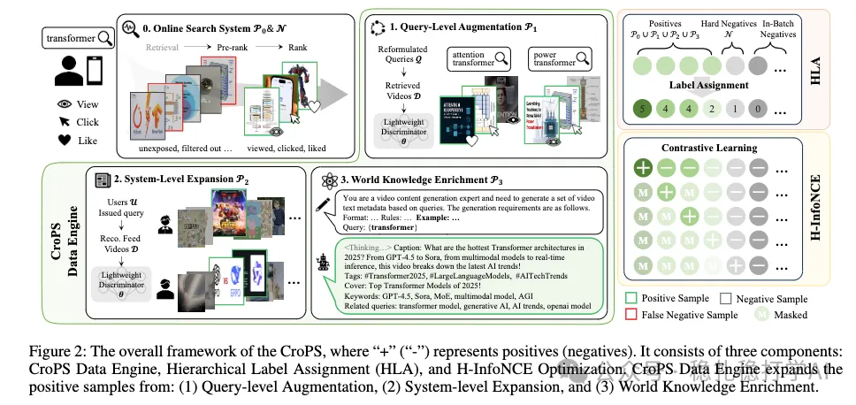

# 推荐算法(2025.11.21)：快手，ebr召回，正样本找的真全

> 原文：https://mp.weixin.qq.com/s/MPWLKFU6d2iYm9TuWPem6g
> 作者：算法工程师刘明星（稳扎稳打学AI）| 发表于 2025-11-21

嘿，记得给“稳扎稳打学AI”添加星标

关注我，每天为你精挑细选最优质、最新鲜的推荐算法paper，陪你一起保持进步、不断精进！

👆 [本公众号paper推荐原则](https://mp.weixin.qq.com/s/BhVGu0qH5kTz9N5zpsD3KA)

1 CroPS: Cross-Scenario Positive Sample Enrichment for EBR

网址：https://arxiv.org/pdf/2511.18008

公司：快手

思想：样本的找全

方向：召回+ebr+负样本

解读：

快手搜索召回，用多维度的方法挖掘更多的正样本；从Query、系统和世界知识3个维度来找；分为三个部分：1 CroPS Data Engine，2 HLA，3 H-InfoNCE。

（1）CroPS Data Engine：本文核心。目的是给每一个query，找出来更多的正样本。包括3个维度：

1级：Query-level Augmentation（Query级增强）：查询改写（query reformulation）和查询扩展（query expansion）两种。查询改写，就是query和query之间建立关联，如果两个query的文本含义相似，相似度高于一个阈值（0.7）就认为是改写关系，那么就把这两个query的正样本合并起来。查询扩展，就是根据query，扩展示例性的query，然后取这些扩展query的正样本，认为是该query的正样本。做法是利用搜索日志中用户历史查询，统计共现关系，构建query之间的相似关系。

2级：System-level Expansion（系统级扩展）：从召回系统里，提取出更多的正样本。包括3类：系统返回未曝光样本（曝光了但未点击）、系统召回未排序样本（系统召回出来了，但是没有进入排序环节）、以及排序未曝光样本（进入了排序环节，但是没有曝光）。这3类样本，都有可能成为该query的正样本。

3级：World Knowledge Enrichment（世界知识增强）：这个level的正样本，是通过大语言模型（LLM）生成的。包括2类：世界知识增强、点击视频等3类。其中，系统级增强，就是搜索过该query的用户，他们实际消费的item里，找出与query很相似的。世界知识增强，就是使用大语言模型（如Qwen2.5-14B）作为伪检索器，生成查询相关的合成视频描述。

（2）层次化计算Loss（Hierarchical Label Assignment）：根据正样本来自哪个level，给正样本赋予不同的label。Level越高的正样本越重要，分配的标签值就越高。比如：原始正样本的level是5，Query级增强的level是4，系统级增强的level是3，世界知识增强的level是2，负样本的level是0。

（3）层次化InfoNCE（H-InfoNCE）：将所有item按照优先级分成不同的level，分别计算Loss。公式（2）是一个通用的InfoNCE损失函数，分子是正样本与query的相似度，分母是它，加上比它level低的所有item与query的相似度。

然后，计算所有level的Loss之和，作为最终的Loss：假设level 5的item有3个，level2的有2个，level3 有6个，level 2的有4个，level 1的有5个，level 0（负样本）有100个。那么在公式（3）里有多少个term呢？答案是：3 +2+6+4+5=20个。level 0（负样本）有100个，不计算在内，因为它们是分母。

这样做的好处是：高level的item不仅在分子中出现，还在低level的item的分母中出现，从而强化了高level item的重要性。

AB：CTR +0.869%、LPR +0.483%。

心得：

（1）ebr挖掘样本是业界主要方法之一。

（2）挖掘出来好的样本，如何使用很重要，本文是通过优先级比较的方法。

愚见：

优先级人工定义写死，还是有优化空间的，还可以做的更细。

可信度：生产

推荐等级：有实践价值

请帮忙点赞、转发，谢谢。

## 欢迎干货投稿 \ 论文宣传 \ 合作交流

推荐您继续阅读：

■ [推荐算法(2025.11.20)：阿里，用diffusion做特征增强，CTR+2.1%](https://mp.weixin.qq.com/s/Ud2p05jTid8Xc2kk9A1m9A)

■ [从检索到生成：快手的 Search-based 长短期兴趣生成式召回实践](https://mp.weixin.qq.com/s/fh7sW6yYBlNldoWh9v7GIg)

历史文章索引：https://docs.qq.com/sheet/DYXZTZ0tseHRyZGtt?tab=BB08J2

请入微信群，群内我会给出更深入的解读，还可以共同讨论技术方案、发招聘广告、内推和交友等。

• 铁粉标准：关注公众号一个月以上，且在公众号上累计15次互动（评论、爱心、转发）、或投稿1次，只欢迎技术同学。

• 入群方法：请您加个人微信lmxhappy，我拉您入群，请备注（只我个人看，不公开）。

喜欢的话点个在看吧👇

个人观点，仅供参考
