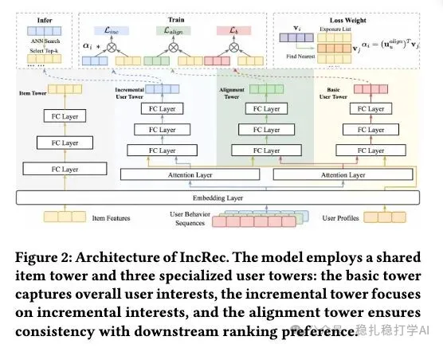

# Daily pick (2025.12.12): Alibaba mines incremental samples from other scenarios, retrieval improves a lot, transaction volume +1.2%

> [中文版](2025-12-12-ali-increc.md)

1 Beyond Existing Retrievals: Cross-Scenario Incremental Sample Learning Framework

Link: https://arxiv.org/pdf/2512.06381

Company: Alibaba

Idea: adding samples

Area: retrieval + cross-domain + EBR

Overview:

Find incremental samples from other scenarios, and on top of the two-tower model add a related incremental tower, trained to capture incremental items. At prediction time, only the incremental tower is used to retrieve incremental items. There are 2 parts: one is the incremental samples, the other is training the incremental network. The prediction method is also explained.

(1) Getting incremental samples

These are items that, within some time after the user's request in the "homepage" scenario (e.g. in the same session), were not retrieved but still got a positive action (e.g. an order). There can be several of them.

Note: in other businesses, the "homepage" scenario can be replaced by something else.

(2) Incremental user tower

On top of the original base two-tower model, an incremental user tower is added. Its positives are the incremental samples; its negatives are the items retrieved on the homepage plus randomly sampled negatives. The reason is that at prediction time it should retrieve only incremental items, not the items the homepage already retrieves (those are covered by the existing retrieval channels). Items retrieved on the homepage serve as hard negatives.

(3) Consistency tower

In particular, retrieval development has a known difficulty: items retrieved by a great retrieval idea get rejected by the later ranking stages. So to help the incremental samples successfully "get through" the downstream stages, the incremental items that are more consistent with the ranking stage need to be picked out first. For this, an auxiliary tower is added: the consistency tower.

The base two-tower model, the incremental user tower and the consistency tower share the embedding layer, so they all shape the embeddings together.

More importantly, it also helps the incremental user tower get through the downstream stages: since the consistency tower can estimate the probability that an item gets through, it is used to compute the pass probability of each incremental sample, which is applied as a weight on the incremental tower's loss. If the pass probability is high, the weight is large, so the sample's loss is large, so the gradient update is large; at prediction time the predicted incremental score becomes larger, and the item is more likely to be retrieved.

Because incremental samples were also never exposed, feeding them straight into the consistency tower (which is built on exposed samples) to compute the probability would be biased. So the item tower is used to find a "proxy" for each incremental sample: search by embedding for the nearest exposed sample.

(3) Prediction

Only the incremental tower is used for prediction.

A/B: on the Taobao homepage, transaction volume +1.2%.

Takeaways:

(1) Adding samples is one of the main ways to improve retrieval, among the top one or two. This paper doesn't focus on network complexity at all.

(2) A single retrieval channel bringing 1%+ transaction volume is a big gain.

Credibility: production

Recommendation: practical value

Figure 2: Architecture of IncRec. The shared item tower encodes all items, while the three specialized user towers separately handle the base task, incremental task, and consistency task.
