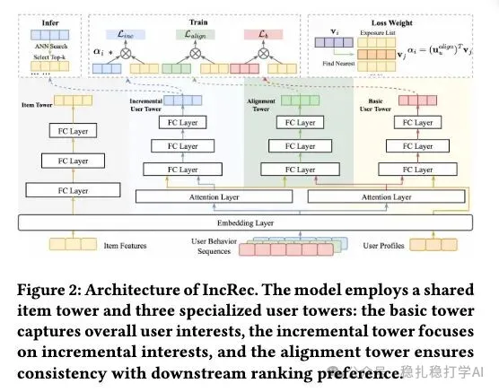

# 推荐算法(2025.12.12)：阿里，挖掘其它域的增量样本，大幅提升召回效果，交易量提升1.2%

> 原文：https://mp.weixin.qq.com/s/VEse6yYsvYQfNR0YOCVeXg
> 作者：算法工程师刘明星（稳扎稳打学AI）| 发表于 2025-12-12

嘿，记得给“稳扎稳打学AI”添加星标

关注我，每天为你精挑细选最优质、最新鲜的推荐算法paper，陪你一起保持进步、不断精进！

> [English version](2025-12-12-ali-increc.full.en.md)

👆 [本公众号paper推荐原则](https://mp.weixin.qq.com/s/BhVGu0qH5kTz9N5zpsD3KA)

1 Beyond Existing Retrievals: Cross-Scenario Incremental Sample Learning Framework

网址：https://arxiv.org/pdf/2512.06381

公司：阿里

思想：增加样本

方向：召回+跨域+ebr

解读：

从其它场景中寻找增量样本，并在双塔基础上增加相关的增量塔，以训练其抓取增量item的能力。预测的时候，只用增量塔召回增量item。包括2部分，一个是增量样本，另一个是训练增量网络。还要，讲解一下预估方法。

（1）增量样本的获取

就是用户在“首页”场景请求后的一定时间内（如，同一个session），没有召回但是却有正向行为（如下单）的item。可以是多个。

注意，“首页”场景，在其它业务里，可以换成其它。

（2）增量用户塔

在原有基本双塔模型里，增加了一个增量用户塔，正样本是增量样本，负样本是首页召回的item和随机采样的负样本。之所以这样，就是为了在预测的时候，只召回增量的item，而不是首页召回的item（这个在已有召回同路里实现）。首页召回的item是一种hard negatives。

（3）一致塔

特别的，召回开发有一个难点，就是很棒的召回想法召回的物料，会被后续的排序环节拒绝，所以为了让增量样本成功“冲卡”。所以需要优先筛选出来与排序环节更加一致的增量item。为此，增加了一个辅助塔——一致塔

基本双塔、增量用户塔和一致塔共享embedding layer，可以共同影响embed。

更加关键的是，还用帮助增量用户塔提升冲卡的目的，即因为一致塔可以评估物料冲卡成功的几率，所以用一致塔计算增量样本的冲卡几率，并以将其作为加权权重作用到增量塔的Loss上。如果冲卡几率大，那么权重大，那么样本的Loss就大，那么梯度更新就大，在预估的时候，预估的增量分数变大，更容易召回。

因为增量样本也没有曝光，直接将曝光样本作为一致塔的输入而计算几率，会有bias。因此，就用item塔找一个增量样本的“代理”——用embed搜一个最近的曝光样本。

（3）预估

只用增量塔预估。

AB: 在淘宝首页，交易量提升1.2%。

心得：

（1）增加样本是提高召回效果的主要手法之一，数一数二。本文都没有专注在网络的复杂度上。

（2）一路召回就带来1%+的交易量提升，这个提升是很大的。

可信度：生产

推荐等级：有实践价值

Figure 2: Architecture of IncRec. The shared item tower encodes all items, while the three specialized user towers separately handle the base task, incremental task, and consistency task.

请帮忙点赞、转发，谢谢。

## 欢迎干货投稿 \ 论文宣传 \ 合作交流

推荐您继续阅读：

[Meta的one model，全链路gpu算子化](https://mp.weixin.qq.com/s/yvaTutx8PiMoS184ts_Tew)

[推荐算法(2025.12.4)：阿里广告，三年磨一剑，搜索相关性指标+27%](https://mp.weixin.qq.com/s/wly9f8dWTkIp7pYM8j-ANg)

历史文章索引：https://docs.qq.com/sheet/DYXZTZ0tseHRyZGtt?tab=BB08J2

请入微信群，群内我会给出更深入的解读，还可以共同讨论技术方案、发招聘广告、内推和交友等。

• 铁粉标准：关注公众号一个月以上，且在公众号上累计15次互动（评论、爱心、转发）、或投稿1次，只欢迎技术同学。

• 入群方法：请您加个人微信lmxhappy，我拉您入群，请备注（只我个人看，不公开）。

喜欢的话点个在看吧👇

个人观点，仅供参考
