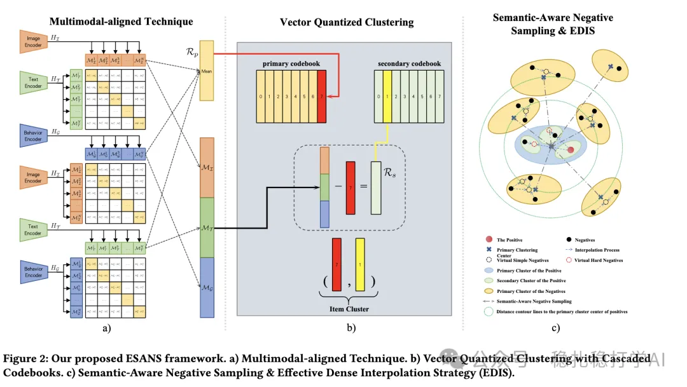

# Recommendation papers (2025.2.25): Alibaba ESANS uses multimodal alignment and codebook clustering for semantic-aware negative sampling in retrieval
> [中文版](2025-02-25-ali-esans-negative-sampling.md)

> Source: WeChat post https://mp.weixin.qq.com/s?__biz=MzkzNDYyNjM1NA==&mid=2247484189&idx=1&sn=c256db252d5aa7ce3629b8c45953a2d5&scene=21#wechat_redirect, published 2025-02-25.
> Split from the roundup "Recommendation papers, fast! The latest practical results from four big companies"; same issue: [Meta unified semantic and ID representation](../sid/2025-02-25-meta-unified-semantic-id.full.en.md), [Google LR-Recsys contrastive explanations](../llm4rec/2025-02-25-google-llm-contrastive-explanations.full.en.md), [Huawei SCCDR cross-domain contrastive learning](../cross-domain-recommendation/2025-02-25-huawei-separated-contrastive-cdr.full.en.md), [Alibaba ESANS semantic-aware negative sampling](../deep-retrieval/2025-02-25-ali-esans-negative-sampling.full.en.md).

Intro of this issue:

This post focuses on frontier research in recommender systems, covering LLM recommendation, cross-domain recommendation, and embedding-based retrieval. It walks through four papers from well-known companies and gives takeaways and recommendation levels.

ESANS: Effective and Semantic-Aware Negative Sampling for Large-Scale Retrieval Systems

Link: https://arxiv.org/pdf/2502.16077

Company: Alibaba

Area: embedding-based retrieval (including negative sampling)

Overview: By combining a Multimodal-aligned Technique, Vector Quantized Clustering with Cascaded Codebooks, Semantic-Aware Negative Sampling, and an Effective Dense Interpolation Strategy (EDIS), it fixes the randomness problem of traditional negative sampling and improves the performance of large-scale retrieval systems.

Takeaways: This is another result that uses real-time k-means to get group partitions and group representations. This is not the end of the innovation, only the beginning; more application innovations will follow.

Credibility: production

Recommendation: worth reading

Figure 2: Our proposed ESANS framework. a) Multimodal-aligned Technique. b) Vector Quantized Clustering with Cascaded Codebooks. c) Semantic-Aware Negative Sampling & Effective Dense Interpolation Strategy (EDIS).
