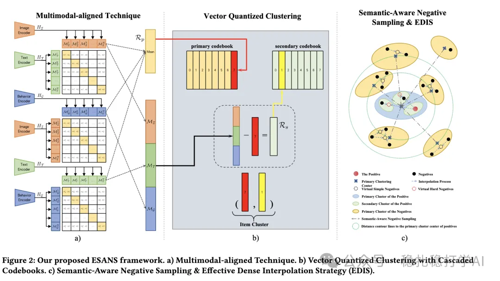

# 推荐算法(2025.2.25)：阿里 ESANS 用多模态对齐和码本聚类做语义感知的召回负采样

> 原文：https://mp.weixin.qq.com/s?__biz=MzkzNDYyNjM1NA==&mid=2247484189&idx=1&sn=c256db252d5aa7ce3629b8c45953a2d5&scene=21#wechat_redirect
> 作者：算法工程师刘明星（稳扎稳打学AI）| 发表于 2025-02-25
> 本文拆自《推荐算法paper速冲！四大厂最新实用科技成果》，同期 4 篇：[Meta 语义与 ID 统一表征](../sid/2025-02-25-meta-unified-semantic-id.md)、[Google LR-Recsys 对比解释](../llm4rec/2025-02-25-google-llm-contrastive-explanations.md)、[华为 SCCDR 跨域对比学习](../cross-domain-recommendation/2025-02-25-huawei-separated-contrastive-cdr.md)、[阿里 ESANS 语义感知负采样](../deep-retrieval/2025-02-25-ali-esans-negative-sampling.md)。

关注我，每天为你精挑细选最优质、最新鲜的推荐算法paper，陪你一起保持进步、不断精进！

> [English version](2025-02-25-ali-esans-negative-sampling.full.en.md)

当期前言：

这篇文章主要聚焦于推荐系统领域的前沿研究，涉及 LLM 推荐、跨域推荐和向量召回等方向，解读了四篇来自知名企业的论文，并给出了心得和推荐等级。

ESANS: Effective and Semantic-Aware Negative Sampling for Large-Scale Retrieval Systems

网址：https://arxiv.org/pdf/2502.16077

公司：阿里

方向：向量召回（包括负采样）

解读：通过多模态对齐技术（Multimodal-aligned Technique）、向量量化聚类技术（Vector Quantized Clustering with Cascaded Codebooks）和语义感知负采样（Semantic-Aware Negative Sampling）与有效稠密插值策略（Effective Dense Interpolation Strategy，EDIS）相结合，改进了传统负采样的随机性问题，提升了大模型检索系统的性能。

心得：这又是一篇通过实时kmeans获取群体划分及群组表征的成果。这不是创新的结束，这只是开始，后面还会其他应用创新。

可信度：生产

推荐等级：推荐看看

Figure 2: Our proposed ESANS framework. a) Multimodal-aligned Technique. b) Vector Quantized Clustering with Cascaded Codebooks. c) Semantic-Aware Negative Sampling & Effective Dense Interpolation Strategy (EDIS).
