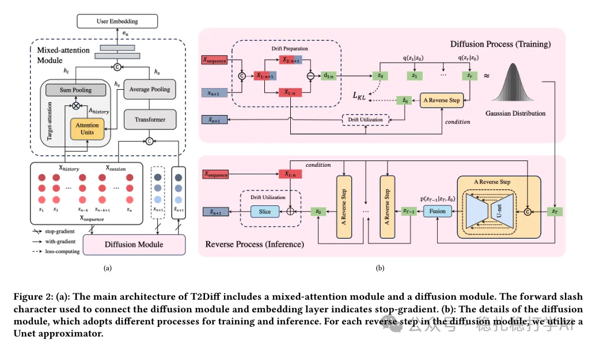

# Recommendation papers (2025.3.3): Kuaishou uses a diffusion model to add cross-interaction to two-tower retrieval
> [中文版](2025-03-03-kuaishou-diffusion-two-tower.md)

> Source: WeChat post https://mp.weixin.qq.com/s?__biz=MzkzNDYyNjM1NA==&mid=2247484276&idx=1&sn=134d4e8c042b893caaad63a3666429c2&scene=21#wechat_redirect, published 2025-03-03.
> Split from the roundup "Recommendation papers (2025.3.3): quick look! Two new industrial-style papers from Kuaishou"; same issue: [Kuaishou diffusion two-tower retrieval](../deep-retrieval/2025-03-03-kuaishou-diffusion-two-tower.full.en.md), [Kuaishou creator-side recommendation](../long-tail/2025-03-03-kuaishou-creator-side-rec.full.en.md).

Unleashing the Potential of Two-Tower Models: Diffusion-Based Cross-Interaction for Large-Scale Matching

Link: https://arxiv.org/pdf/2502.20687

Company: Kuaishou

Area: embedding retrieval (two-tower retrieval)

Overview: Diffusion models can also help in embedding retrieval. The core idea is to take an item embedding as input and output an item embedding, just with some added noise, so more information can be learned and retrieval improves.

Put simply, a diffusion model is used to augment the item embedding, which improves retrieval.

Takeaways: (meant as a compliment) Everything can be diffusion. Dear friends, use diffusion for everything, and let diffusion try whether it improves results.

Credibility: production

Recommendation: worth reading

