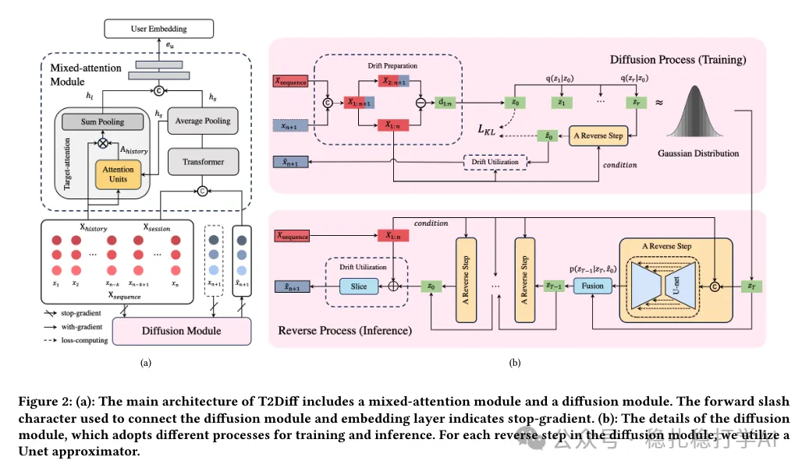

# 推荐算法(2025.3.3)：快手用扩散模型增强双塔召回的交叉交互

> 原文：https://mp.weixin.qq.com/s?__biz=MzkzNDYyNjM1NA==&mid=2247484276&idx=1&sn=134d4e8c042b893caaad63a3666429c2&scene=21#wechat_redirect
> 作者：算法工程师刘明星（稳扎稳打学AI）| 发表于 2025-03-03
> 本文拆自《推荐算法(2025.3.3)：速看！快手两篇工业风的最新研究成果》，同期 2 篇：[快手扩散双塔召回](../deep-retrieval/2025-03-03-kuaishou-diffusion-two-tower.md)、[快手创作者侧推荐](../long-tail/2025-03-03-kuaishou-creator-side-rec.md)。

关注我，每天为你精挑细选最优质、最新鲜的推荐算法paper，陪你一起保持进步、不断精进！

> [English version](2025-03-03-kuaishou-diffusion-two-tower.full.en.md)

Unleashing the Potential of Two-Tower Models: Diffusion-Based Cross-Interaction for Large-Scale Matching

网址：https://arxiv.org/pdf/2502.20687

公司：快手

方向：向量召回（双塔召回）

解读：扩散模型在向量召回上也能起到作用。核心思想是输入一个item的embedding，输出一个item的embedding，只是多了一些噪声，这样就可以学到更多的信息，提升召回效果。

简单地说，就是用扩散模型把item的embedding做一下增强，这样就可以提升召回效果。

心得：（褒义）完事可以diffusion，亲爱的朋友们，什么都用diffusion吧，让diffusion试试可否提升效果。

可信度：生产

推荐等级：推荐看看

