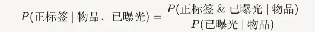

# Recommendation papers (2025.4.1): Meta decouples exposure from engagement to ease popularity bias in retrieval
> [中文版](2025-04-01-meta-position-biased-retrieval.md)

> Source: WeChat post https://mp.weixin.qq.com/s?__biz=MzkzNDYyNjM1NA==&mid=2247484391&idx=1&sn=ef838380260b349648ae9d9bc69b52ab&scene=21#wechat_redirect, published 2025-04-01.
> Split from the roundup "Recommendation papers (2025.4.1): industrial style all the way! Work from Meta, Baidu and Microsoft"; same issue: [Meta position-biased item selection](../deep-retrieval/2025-04-01-meta-position-biased-retrieval.full.en.md), [Microsoft Wasserstein reranking](../loss-func/2025-04-01-microsoft-wasserstein-rerank.full.en.md), [Baidu CoRanking small/large model collaborative ranking](../llm4rec/2025-04-01-baidu-coranking.full.en.md).

Position-Biased Item Selection for Recommendation

Link: https://arxiv.org/pdf/2503.23437

Company: Meta

Area: retrieval

Overview:

In the retrieval stage of a recommender system, selecting the right item list is crucial. Existing methods usually prioritize items by ranking score, but this suffers from popularity bias. Meta's new method decouples exposure from engagement and proposes a novel way to retrieve.

(1) Background: the retrieval stage has to quickly filter a candidate set from a huge item pool. Traditional methods usually compute item ranking scores from user interaction data (clicks, views, etc.). The score is usually expressed as the probability P(positive label & exposed | item}), where positive label means a positive interaction with the item (e.g. watch, like); exposed means the item has been recommended to the user and had a chance to be interacted with; item is the specific content to be recommended (e.g. a video, a product). Under this definition, an item's ranking score directly reflects the joint probability that it is exposed and gets a positive interaction. But this has a serious problem: it is naturally biased toward popular items that are already exposed often, because they have more chances to accumulate positive interactions, while niche or new items are underrated because they get little exposure, which makes popularity bias worse.

(2) New method: P(positive label | item, exposed}). Meaning: this probability is the likelihood that the user interacts positively with the item given that it has been exposed. It focuses on the item's intrinsic appeal (whether the user likes it after seeing it), rather than the direct effect of how many times it was exposed.

Benefit: exposure and engagement are decoupled. Traditional methods mix exposure and engagement together, so popular items win because of high exposure, and niche or new items are underrated because of low exposure. The new method gives them a fair chance to compete, since the score is based only on "performance after exposure". By relying less on popular content, the recommender can retrieve more unique or long-tail content, break the "filter bubble" and improve user experience.

Takeaways: none

Credibility: offline

Recommendation: worth reading
