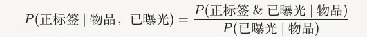

# 推荐算法(2025.4.1)：Meta解耦曝光与参与度缓解召回流行度偏差

> 原文：https://mp.weixin.qq.com/s?__biz=MzkzNDYyNjM1NA==&mid=2247484391&idx=1&sn=ef838380260b349648ae9d9bc69b52ab&scene=21#wechat_redirect
> 作者：算法工程师刘明星（稳扎稳打学AI）| 发表于 2025-04-01（修改于 2025-04-01）
> 本文拆自《推荐算法(2025.4.1)：工业风拉满！Meta、百度、微软的成果》，同期 3 篇：[Meta 位置偏置物品选择](../deep-retrieval/2025-04-01-meta-position-biased-retrieval.md)、[微软 Wasserstein 重排](../loss-func/2025-04-01-microsoft-wasserstein-rerank.md)、[百度 CoRanking 大小模型协作排序](../llm4rec/2025-04-01-baidu-coranking.md)。

关注我，每天为你精挑细选最优质、最新鲜的推荐算法paper，陪你一起保持进步、不断精进！

> [English version](2025-04-01-meta-position-biased-retrieval.full.en.md)

Position-Biased Item Selection for Recommendation

网址：https://arxiv.org/pdf/2503.23437

公司：Meta

方向：召回

解读：

在推荐系统的检索阶段，选择一个合适的物品列表是至关重要的。现有的方法通常通过排序分数来决定物品的优先级，但这种方法存在流行度偏差问题。Meta 的新方法通过将曝光与参与度的解耦，提出了一种新颖的检索方式。

（1）背景：推荐系统的检索阶段需要从海量物品中快速筛选出候选集，传统方法通常基于用户交互数据（如点击、观看等）计算物品的排名分数。这种分数通常用概率 P(正标签 & 已曝光 | 物品}) 表示，其中，正标签：表示用户对物品的正向交互（如观看、点赞）。已曝光：表示物品已被推荐给用户并有机会被交互。物品：待推荐的具体内容（如视频、商品）。在这种定义下，物品的排名分数直接反映了它被曝光且获得正向交互的联合概率。然而，这种方式有一个严重问题：它天然偏向于已经频繁曝光的热门物品，因为这些物品有更多机会积累正向交互数据，而小众或新物品因曝光少而被低估，导致流行度偏差加剧。

（2）新方法：P(正标签 | 物品, 已曝光})，含义：这个概率表示在给定物品已被曝光的前提下，用户对其产生正向交互的可能性。它关注的是物品的内在吸引力（即用户看到它后是否喜欢），而不是曝光次数的直接影响。

好处：解耦曝光与参与度。传统方法将曝光和参与度混为一谈，导致热门物品因高曝光而占据优势。小众或新物品因曝光少而在传统方法中被低估。新方法赋予它们公平竞争的机会，因为评分只基于“已曝光后的表现”。通过减少对热门内容的依赖，推荐系统能检索更多独特或长尾内容，打破“过滤泡沫”，提升用户体验。

心得：无

可信度：离线

推荐等级：推荐看看
