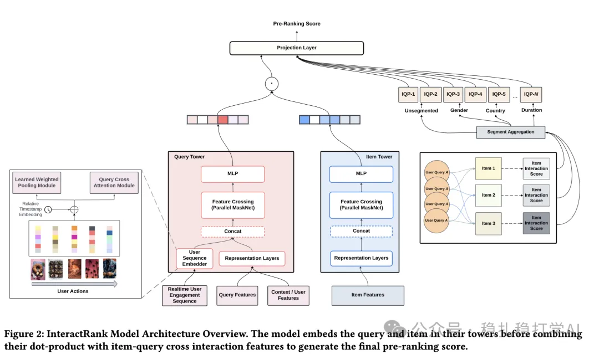

# Daily pick (2025.4.11): a taste of Pinterest's industrial style

> [中文版](2025-04-11-pinterest-interactrank.md)

1 InteractRank: Personalized Web-Scale Search Pre-Ranking with Cross Interaction Features

Link: https://arxiv.org/pdf/2504.06609

Company: Pinterest

Area: pre-ranking + two-tower

Overview:

On top of a two-tower pre-ranking architecture, a third tower is added in parallel to model statistical probability information for (query, item) pairs (IQP). The three are fused through inner products and an affine transform.

The (query, item) statistical probability is the number of times the two co-occur divided by the number of times the query occurs. It is a non-personalized statistic. It is generated across several segment dimensions, e.g. time windows: 7 days, 90 days, 1 year, 2 years; user segments: gender, country, unsegmented, etc.; context segments: device type, query language, etc.

These statistics can be computed offline and cached. At training and prediction time, the ones related to the query and the candidate item are fetched and used in the computation.

In addition, the two towers are further improved with contrastive learning (batch negatives).

Takeaways:

(1) Cross interaction features, based on users' historical interaction logs (clicks, saves, etc.), give the historical probability of how an item performs under a specific query, which significantly improves relevance.

(2) Adding more towers in parallel has long been a very mature practice. But Pinterest's write-up has no frills, just industrial-style sharing, which deserves respect.

Credibility: production

Recommendation: practical value

