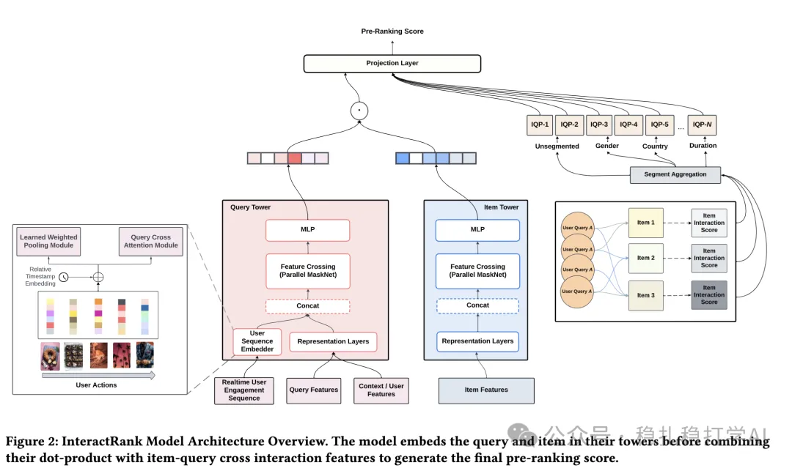

# 推荐算法(2025.4.11)：感受Pinterest的工业风

> 原文：https://mp.weixin.qq.com/s?__biz=MzkzNDYyNjM1NA==&mid=2247484446&idx=1&sn=ad4829937056426df3ec899d299d4692&scene=21#wechat_redirect
> 作者：算法工程师刘明星（稳扎稳打学AI）| 发表于 2025-04-11

嘿，记得给“稳扎稳打学AI”添加星标

关注我，每天为你精挑细选最优质、最新鲜的推荐算法paper，陪你一起保持进步、不断精进！

📄 [本公众号paper推荐原则](https://mp.weixin.qq.com/s?__biz=MzkzNDYyNjM1NA==&mid=2247484097&idx=1&sn=18322c279290b555eb030e12953b7c7f&scene=21#wechat_redirect)

1 InteractRank: Personalized Web-Scale Search Pre-Ranking with Cross Interaction Features

网址：https://arxiv.org/pdf/2504.06609

公司：Pinterest

方向：粗排+双塔

解读：

粗排双塔架构基础上，并列增加了一个塔，建模（query，item）的统计概率信息（IQP），这3者通过内积和仿射变换融合。

（query，item）的统计概率信息是两者共现的次数，除以query的次数。非个性化的统计指标。按多个维度分段生成，例如：时间段：7天、90天、1年、2年；用户分段：性别（Gender）、国家（Country）、未分段（Unsegmented）等；上下文分段：设备类型、查询语言等。

该统计信息可以离线计算好，并cache。训练和预估的时候，获取query、candidate item相关的参与运算。

另外，对双塔还通过对比学习（batch negatives）做效果增强。

心得：

（1）跨交互特征基于用户历史交互日志（如点击、保存等），提供条目在特定查询下的历史表现概率，显著提升相关性。

（2）并列更多塔的做法早已是非常成熟的做法。但，Pinterest没有花哨，只有工业风的分享，值得敬畏。

可信度：生产

推荐等级：有实践价值

请帮忙点赞、转发，谢谢。您认为哪篇论文最有潜力应用到实际业务中？

## 欢迎干货投稿 \ 论文宣传 \ 合作交流

推荐您继续阅读：

■ [推荐算法(2025.4.10)：腾讯第三次证明相似物料提升推荐效果](https://mp.weixin.qq.com/s?__biz=MzkzNDYyNjM1NA==&mid=2247484439&idx=1&sn=7e51fbafb8826568be5fd537a0cd83aa&scene=21#wechat_redirect)

■ [推荐算法(2025.4.9)：快手再次证明相似物料提升推荐效果](https://mp.weixin.qq.com/s?__biz=MzkzNDYyNjM1NA==&mid=2247484431&idx=1&sn=c0598c45d25962ffad3b9f281d169f1e&scene=21#wechat_redirect)

■ [推荐算法(2025.4.8)：魔鬼藏在细节里](https://mp.weixin.qq.com/s?__biz=MzkzNDYyNjM1NA==&mid=2247484424&idx=1&sn=103d2fab460bb03ccfd332c5f1c2f0a3&scene=21#wechat_redirect)

历史文章索引：https://docs.qq.com/sheet/DYXZTZ0tseHRyZGtt?tab=BB08J2

由于公众号试行乱序推送，您可能不再准时收到稳扎稳打学AI的推送。为了第一时间收到本号的干货内容， 请将本号设为星标，以及常点文末右下角的“在看”。

喜欢的话点个在看吧 👇

个人观点，仅供参考
