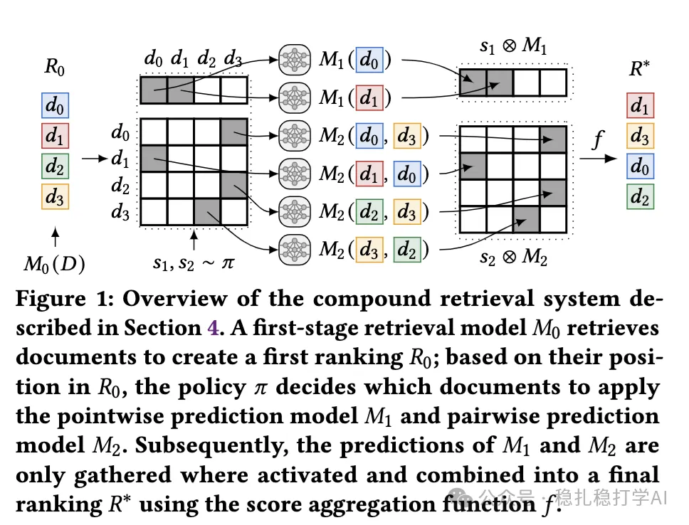

# Daily pick (2025.4.17): look! Google putting LLMs to work in search

> [中文版](2025-04-17-google-compound-retrieval.md)

Optimizing Compound Retrieval Systems

Link: https://arxiv.org/pdf/2504.12063

Company: Google

Area: LLM

Overview:

The paper proposes a compound retrieval system that combines the classic BM25 retrieval method with pointwise and pairwise large language model (LLM) predictions. LLMs are inefficient, so the number of LLM calls is made one of the training objectives; as a result only a small number of items go through LLM prediction, achieving a trade-off between the overall effectiveness and efficiency of the system.

Core components:

(1) Selection policy: decides which documents or document pairs need model predictions, represented as a probability distribution (which can be turned into a deterministic policy after optimization).

(2) Score aggregation function: combines the model predictions (e.g. BM25 scores, LLM pointwise/pairwise predictions) into the final ranking score.

(3) Objective function: optimizes the trade-off between effectiveness (ranking quality, e.g. nDCG) and efficiency (number of LLM calls) through linear interpolation.

Takeaways: LLMs are slow but effective. To deploy them in recommender systems with efficiency requirements, you need to come up with some tricks. This paper proposes a deployment approach guided by the stacking method from ensemble learning.

Credibility: offline

Recommendation: practical value

Figure 1: Overview of the compound retrieval system described in Section 4. A first-stage retrieval model M0 retrieves documents to create a first ranking R0; based on their position in R0, the policy π decides which documents to apply the pointwise prediction model M1 and pairwise prediction model M2. Subsequently, the predictions of M1 and M2 are only gathered where activated and combined into a final ranking R* using the score aggregation function f.
