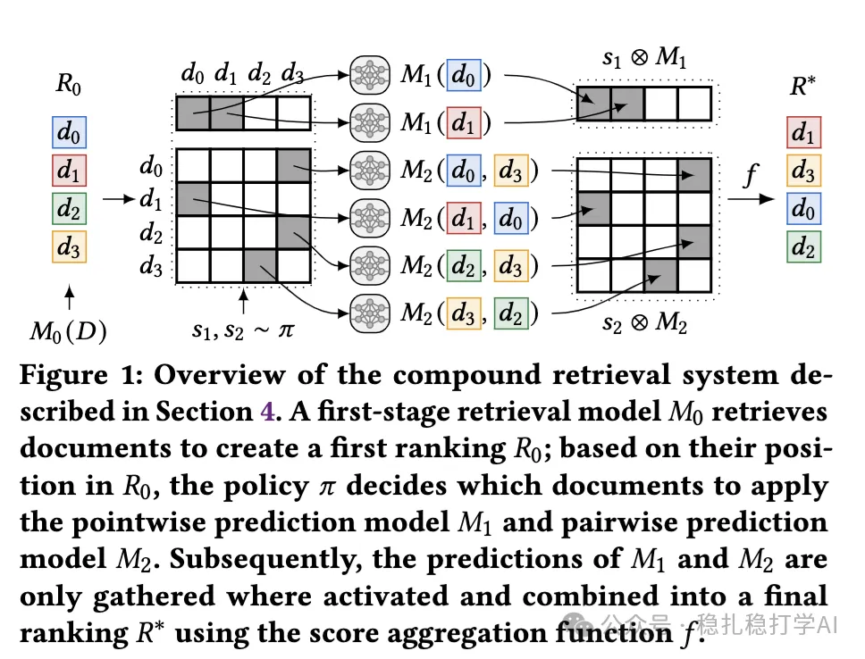

# 推荐算法(2025.4.17)：看！谷歌的LLM在搜索上的落地

> 原文：https://mp.weixin.qq.com/s?__biz=MzkzNDYyNjM1NA==&mid=2247484500&idx=1&sn=8e05a2de7d8426ddcc509076ec554187&scene=21#wechat_redirect
> 作者：算法工程师刘明星（稳扎稳打学AI）| 发表于 2025-04-17

嘿，记得给“稳扎稳打学AI”添加星标

关注我，每天为你精挑细选最优质、最新鲜的推荐算法paper，陪你一起保持进步、不断精进！

> [English version](2025-04-17-google-compound-retrieval.full.en.md)

📄 [本公众号paper推荐原则](https://mp.weixin.qq.com/s?__biz=MzkzNDYyNjM1NA==&mid=2247484097&idx=1&sn=18322c279290b555eb030e12953b7c7f&scene=21#wechat_redirect)

Optimizing Compound Retrieval Systems

网址：https://arxiv.org/pdf/2504.12063

公司：google

方向：LLM

解读：

提出一个复合检索系统，将经典的 BM25 检索方法与基于点的和基于成对的大语言模型（LLM）预测相结合。大模型的效率低，通过将大语言模型的调用次数作为训练目标之一，从而实现了少量item才通过LLM的预测，实现了系统整体的有效性与效率之间的权衡关系。

核心组件包括：

（1）选择策略：决定哪些文档或文档对需要模型预测，使用概率分布表示（优化后可转为确定性策略）。

（2）评分聚合函数：将模型预测（如BM25分数、LLM点式/对式预测）组合为最终排名分数。

（3）目标函数：通过线性插值优化效果（排名质量，如nDCG）和效率（LLM调用次数）之间的权衡。

心得：大语言模型效率低但是效果好，要在对效率有要求的推荐系统上落地，要想一些法子。本文是在集成学习的stacking方法的指导下，提出的一种落地方案。

可信度：离线

推荐等级：有实践价值

Figure 1: Overview of the compound retrieval system described in Section 4. A first-stage retrieval model M0 retrieves documents to create a first ranking R0; based on their position in R0, the policy π decides which documents to apply the pointwise prediction model M1 and pairwise prediction model M2. Subsequently, the predictions of M1 and M2 are only gathered where activated and combined into a final ranking R* using the score aggregation function f.

请帮忙点赞、转发，谢谢。您认为哪篇论文最有潜力应用到实际业务中？

## 欢迎干货投稿 \ 论文宣传 \ 合作交流

推荐您继续阅读：

■ [推荐算法(2025.4.16)：Pinterest & Amazon](https://mp.weixin.qq.com/s?__biz=MzkzNDYyNjM1NA==&mid=2247484494&idx=1&sn=4765dee4aa47534d3892f6f9b9fdb89c&scene=21#wechat_redirect)

■ [推荐算法(2025.4.15)：3篇大厂非大模型相关的论文](https://mp.weixin.qq.com/s?__biz=MzkzNDYyNjM1NA==&mid=2247484486&idx=1&sn=6687984fa2dd4d718ea0c55554f2747d&scene=21#wechat_redirect)

■ [推荐算法周报(2025.4.14)：RQ-VAE火热的原因是能够有效整合多模态数据](https://mp.weixin.qq.com/s?__biz=MzkzNDYyNjM1NA==&mid=2247484480&idx=1&sn=0c531ba308bbccf11df8f74a77b99c66&scene=21#wechat_redirect)

历史文章索引：https://docs.qq.com/sheet/DYXZTZ0tseHRyZGtt?tab=BB08J2

由于公众号试行乱序推送，您可能不再准时收到稳扎稳打学AI的推送。为了第一时间收到本号的干货内容， 请将本号设为星标，以及常点文末右下角的“在看”。

喜欢的话点个在看吧 👇

个人观点，仅供参考
