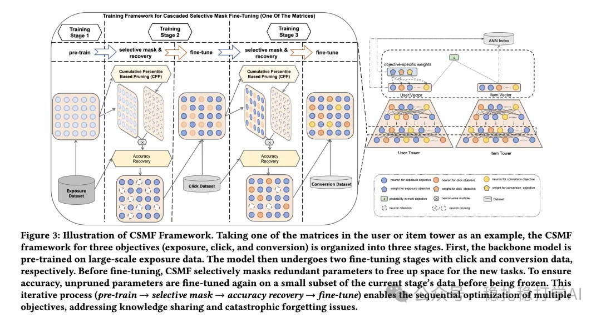

# Recommendation papers (2025.4.18): Alibaba's multi-objective two-tower retrieval

> [中文版](2025-04-18-ali-csmf.md)

1 CSMF: Cascade Selective Mask Fine-Tuning for Multi-Objective Embedding-Based Retrieval

Link: https://arxiv.org/pdf/2504.12920

Company: Alibaba

Area: EBR (embedding-based retrieval)

Overview:

Using adaptive soft pruning and cascade fine-tuning, it efficiently optimizes multi-objective embedding-based retrieval in a two-tower model, improving performance significantly without adding online cost. In short, training is split into 3 stages by business objective and run in sequence; each stage identifies and masks redundant parameters and trains only the remaining ones. After training, the parameters of one model fall into 3 types, each corresponding to one stage.

Key points:

(1) Cascade fine-tuning: training is split into three stages, pretraining and fine-tuning on exposure, click and conversion data respectively, making full use of the sequential relation between the objectives (exposure → click → conversion).

(2) Selective parameter masking: a cumulative percentile pruning (CPP) method identifies and masks redundant parameters, freeing parameter space for later tasks without increasing model complexity.

(3) Accuracy recovery: after pruning, the unpruned parameters are fine-tuned on a small amount of data to keep the current task accurate, and these parameters are then frozen to preserve knowledge from upstream tasks.

(4) Cross-stage adaptive margin loss (AML): dynamically adjusts the margin between positive and negative pairs, easing optimization conflicts between objectives and reducing negative transfer.

(5) Flexible online multi-objective retrieval: each objective is given a fixed weight and a weighted fused score is computed, so it can be adjusted flexibly for different recommendation scenarios.

Credibility: offline

Recommendation: worth a look

