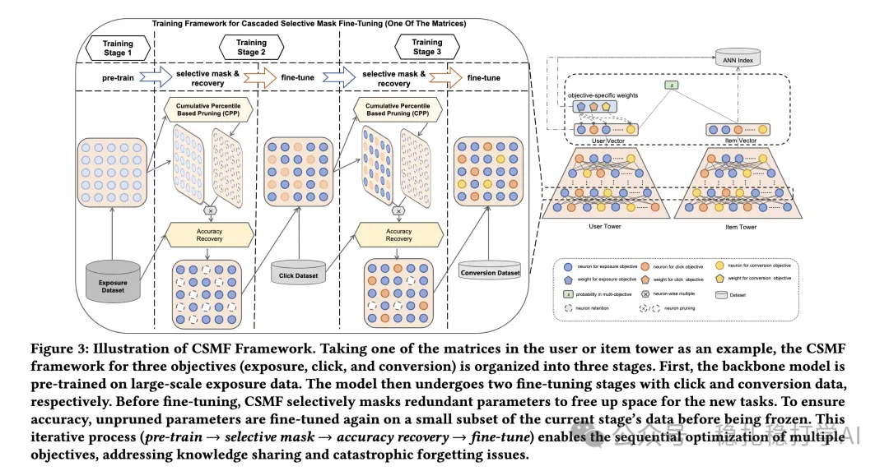

# 推荐算法(2025.4.18)：阿里的多目标双塔召回

> 原文：https://mp.weixin.qq.com/s?__biz=MzkzNDYyNjM1NA==&mid=2247484506&idx=1&sn=f409f9b7619a82bc29457562e5a6e937&scene=21#wechat_redirect
> 作者：算法工程师刘明星（稳扎稳打学AI）| 发表于 2025-04-18

嘿，记得给“稳扎稳打学AI”添加星标

关注我，每天为你精选推荐系统的最新好论文。

> [English version](2025-04-18-ali-csmf.full.en.md)

📄 [本公众号paper推荐原则](https://mp.weixin.qq.com/s?__biz=MzkzNDYyNjM1NA==&mid=2247484097&idx=1&sn=18322c279290b555eb030e12953b7c7f&scene=21#wechat_redirect)

1 CSMF: Cascade Selective Mask Fine-Tuning for Multi-Objective Embedding-Based Retrieval

网址：https://arxiv.org/pdf/2504.12920

公司：阿里

方向：EBR（embedding-based retrieval）

解读：

通过自适应软剪枝和级联微调，在双塔模型中高效地优化多目标嵌入式检索，显著提升性能且不增加在线开销。就是根据业务分成了3个阶段依次训练，每个阶段识别并屏蔽冗余参数，只训练剩余的参数。这样训练完，一个模型的参数分成了3种类型，每种类型对应一个阶段。

具体的关键点：

（1）级联微调：将训练分为三个阶段，分别针对 exposure、click 和 conversion 数据进行预训练和微调，充分利用目标的序列关系（如 exposure → click → conversion）。

（2）选择性参数屏蔽：通过累积百分位剪枝（CPP）方法，识别并屏蔽冗余参数，为后续任务释放参数空间，避免增加模型复杂度。

（3）精度恢复：在剪枝后，使用少量数据对未剪枝参数进行微调，确保当前任务的准确性，同时冻结这些参数以保留上游任务的知识。

（4）跨阶段自适应边距损失（AML）：动态调整正负样本对的边距，缓解目标间的优化冲突，减少负迁移效应。

（5）灵活的在线多目标检索：通过为每个目标分配定权重，计算加权融合分数，支持不同推荐场景的灵活调整。

可信度：离线

推荐等级：推荐看看

请帮忙点赞、转发，谢谢。您认为哪篇论文最有潜力应用到实际业务中？

## 欢迎干货投稿 \ 论文宣传 \ 合作交流

推荐您继续阅读：

■ [推荐算法(2025.4.17)：看！谷歌的LLM在搜索上的落地](https://mp.weixin.qq.com/s?__biz=MzkzNDYyNjM1NA==&mid=2247484500&idx=1&sn=8e05a2de7d8426ddcc509076ec554187&scene=21#wechat_redirect)

■ [推荐算法(2025.4.16)：Pinterest & Amazon](https://mp.weixin.qq.com/s?__biz=MzkzNDYyNjM1NA==&mid=2247484494&idx=1&sn=4765dee4aa47534d3892f6f9b9fdb89c&scene=21#wechat_redirect)

■ [推荐算法(2025.4.15)：3篇大厂非大模型相关的论文](https://mp.weixin.qq.com/s?__biz=MzkzNDYyNjM1NA==&mid=2247484486&idx=1&sn=6687984fa2dd4d718ea0c55554f2747d&scene=21#wechat_redirect)

历史文章索引：https://docs.qq.com/sheet/DYXZTZ0tseHRyZGtt?tab=BB08J2

由于公众号试行乱序推送，您可能不再准时收到稳扎稳打学AI的推送。为了第一时间收到本号的干货内容， 请将本号设为星标，以及常点文末右下角的“在看”。

喜欢的话点个在看吧 👇

个人观点，仅供参考
