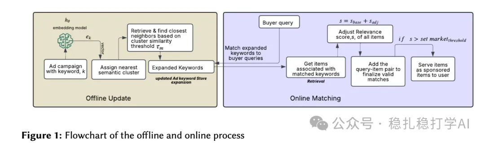

# Recommendation papers (2025.5.27): eBay's keyword retrieval is very practical

> [中文版](2025-05-27-ebay-keyword-recall.md)

1 Improving Ad matching via Cluster-Adaptive Keyword Expansion and Relevance tuning

Link: https://arxiv.org/pdf/2505.18897

Company: eBay

Area: keyword retrieval

Overview: this work broadens keyword coverage through document-side semantic keyword expansion while keeping relevance high.

In practice, an ad's keywords are turned into embeddings by a student network, and ANN search finds the most similar keyword list, which becomes the expanded keywords for that keyword. The expanded keywords are then used to retrieve relevant ads, which widens the coverage of ad retrieval.

The ANN search decides the similar set by a threshold, so the number of retrieved keywords varies dynamically. To raise recall, sparse clusters get a larger threshold than dense clusters.

Concretely, k-means is run offline over all keyword embeddings, which gives each keyword's nearest cluster. From the distribution within a cluster, you can tell whether it is a dense or a sparse cluster, and from that set each cluster's retrieval threshold.

The paper also mentions using GBDT to compute keyword-ad similarity scores, and a similarity bias score between expanded keywords and ads.

Takeaways:

(1) Expansion methods are not new.

(2) They are actually still using GBDT. If it works, there's no need to chase complexity.

(3) Producing adaptive thresholds during k-means is a nice idea that can be applied in many other places.

Credibility: production

Recommendation: practically useful

